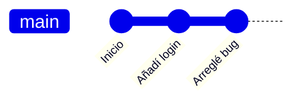

# Introducción a Git

**Git** es un **sistema de control de versiones distribuido** que registra los cambios realizados sobre un conjunto de ficheros a lo largo del tiempo. Fue creado en 2005 por Linus Torvalds para gestionar el desarrollo del kernel de Linux.

```bash
# Comprobar si Git está instalado y ver su versión
git --version
```

---

## ¿Qué problema resuelve Git?

Imagina que estás escribiendo un trabajo importante. Sin ninguna herramienta de control de versiones, probablemente acabarías con una carpeta llena de ficheros como estos:

```
trabajo_final.docx
trabajo_final_v2.docx
trabajo_final_v2_revisado.docx
trabajo_final_DEFINITIVO.docx
trabajo_final_DEFINITIVO_ahora_si.docx
```

Con un equipo de varias personas trabajando sobre el mismo código, este caos se multiplica. Git resuelve exactamente estos problemas:

- **Historial completo**: cada cambio queda registrado con quién lo hizo, cuándo y por qué, los llamamos `commits`.
- **Trabajo en equipo sin conflictos**: varias personas pueden trabajar sobre el mismo proyecto de forma simultánea, esto son `branches` y `merges`.
- **Recuperación ante errores**: si algo se rompe, puedes volver a cualquier versión anterior en segundos, moverte a versiones anteriores es hacer un `checkout`.
- **Experimentación segura**: puedes probar ideas nuevas sin miedo a estropear el código que ya funciona, para esto tenemos elementos como el `stash` o incluso los `branches`.

---

## ¿Cómo funciona Git? La analogía de los puntos de guardado

Piensa en Git como el sistema de **puntos de guardado** de un videojuego. Cada vez que llegas a un punto importante, guardas la partida. Si más adelante tomas una decisión equivocada y el personaje muere, simplemente cargas el último punto de guardado.

En Git, esos puntos de guardado se llaman **commits**. Cada commit es una fotografía del estado completo de tu proyecto en un momento concreto.



---

## Conceptos fundamentales

| Concepto | Descripción |
|----------|-------------|
| **Repositorio** | Carpeta de proyecto donde Git registra todo el historial, tiene una carpeta oculta .git |
| **Commit** | Punto de guardado con un mensaje descriptivo |
| **Rama (branch)** | Línea de desarrollo independiente dentro del mismo repositorio |
| **Remote** | Copia del repositorio alojada en un servidor (GitHub, GitLab, Bitbucket…) |
| **Clone** | Descargar una copia completa de un repositorio remoto |
| **Push** | Enviar tus commits locales al repositorio remoto |
| **Pull** | Traer los commits remotos a tu repositorio local |

---

## Git vs. otros sistemas de control de versiones

| Característica | Git (distribuido) | SVN (centralizado) |
|----------------|-------------------|--------------------|
| Historial completo | En cada máquina local | Solo en el servidor |
| Trabajo sin conexión | Sí | No |
| Velocidad | Muy rápido | Dependiente de red |
| Ramas | Ligeras y rápidas | Costosas |
| Popularidad actual | Estándar de la industria | En declive |

---

## Instalación y configuración inicial

Tras instalar Git ([git-scm.com](https://git-scm.com)), lo primero es identificarte. Git asociará tu nombre y correo a cada commit que realices:

```bash
# Configurar nombre y correo (una sola vez por máquina)
git config --global user.name "Tu Nombre"
git config --global user.email "tu@email.com"

# Verificar la configuración
git config --list
```

:::tip 

Consejo

Usa el mismo correo que tienes en tu cuenta de GitHub o Bitbucket para que tus commits queden vinculados a tu perfil.
:::

---

## Archivos relacionados

- [b-proveedores-web.md](./b-proveedores-web) — GitHub, GitLab y Bitbucket
- [b-repositorio-y-rama-principal.md](./b-repositorio-y-rama-principal) — Cómo gestionar un repositorio en una sola rama
- [c-ramas-y-merge.md](./c-ramas-y-merge) — Crear varias ramas y fusionarlas
- [d-flujos-de-trabajo.md](./d-flujos-de-trabajo) — Organizaciones y flujos de trabajo establecidos
