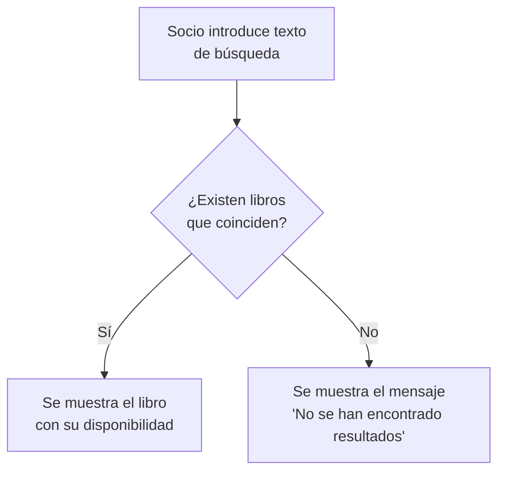

# Solución Ejercicio 4 — Redacción de historias de usuario

## Enunciado

Retomando el sistema de gestión de biblioteca del Ejercicio 1, redactar historias de usuario para distintos roles, comprobar que cumplen INVEST y escribir criterios de aceptación para una de ellas.

---

## 1. Historias de usuario

### Historia 1 — Socio

> Como **socio de la biblioteca**,
> quiero **buscar un libro por título o autor**,
> para **saber si está disponible antes de desplazarme al centro**.

### Historia 2 — Bibliotecario

> Como **bibliotecario**,
> quiero **registrar el préstamo de un libro a un socio**,
> para **llevar un control de qué ejemplares están prestados y a quién**.

### Historia 3 — Administrador del sistema

> Como **administrador del sistema**,
> quiero **consultar un listado de los libros con más préstamos en el último mes**,
> para **decidir qué nuevos ejemplares comprar**.

---

## 2. Comprobación de los criterios INVEST

| Criterio | Historia 1 (Socio) | Historia 2 (Bibliotecario) | Historia 3 (Administrador) |
|---|---|---|---|
| **I**ndependent | Sí, no depende de otra historia | Sí | Sí, aunque necesita que ya existan préstamos registrados |
| **N**egotiable | Sí, el "cómo" se puede negociar (buscador simple o avanzado) | Sí | Sí |
| **V**aluable | Sí, evita desplazamientos innecesarios | Sí, es el núcleo del negocio | Sí, apoya decisiones de compra |
| **E**stimable | Sí | Sí | Sí |
| **S**mall | Sí, cabe en un sprint | Sí | Podría ser grande si incluye filtros y exportación — ver reformulación |
| **T**estable | Sí, se puede comprobar con casos concretos | Sí | Sí |

**Reformulación de la Historia 3** (para que sea más pequeña y testeable):

> Como **administrador del sistema**,
> quiero **ver un listado ordenado con el número de préstamos de cada libro en los últimos 30 días**,
> para **identificar los libros con mayor demanda**.

(Se deja fuera, para una historia aparte, la exportación o los filtros avanzados.)

---

## 3. Criterios de aceptación de la Historia 1

> Como socio de la biblioteca, quiero buscar un libro por título o autor, para saber si está disponible antes de desplazarme.

**Criterio 1:**
- **Dado** que el catálogo contiene el libro "El Quijote"
- **Cuando** el socio busca por el título "quijote" (sin distinguir mayúsculas)
- **Entonces** el sistema muestra ese libro junto con su disponibilidad

**Criterio 2:**
- **Dado** que no existe ningún libro con el título o autor buscado
- **Cuando** el socio realiza la búsqueda
- **Entonces** el sistema muestra el mensaje "No se han encontrado resultados"

**Criterio 3 (adicional):**
- **Dado** que el campo de búsqueda está vacío
- **Cuando** el socio pulsa "Buscar"
- **Entonces** el sistema muestra un aviso pidiendo introducir un texto y no realiza la búsqueda
