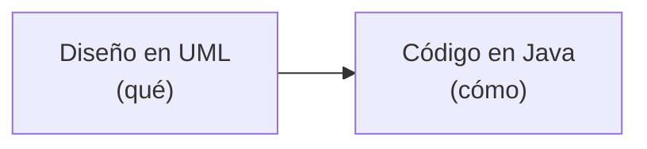
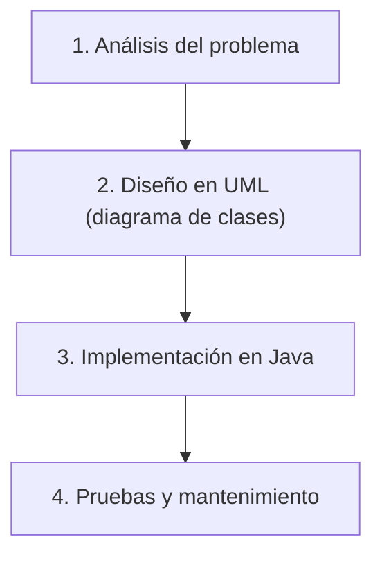
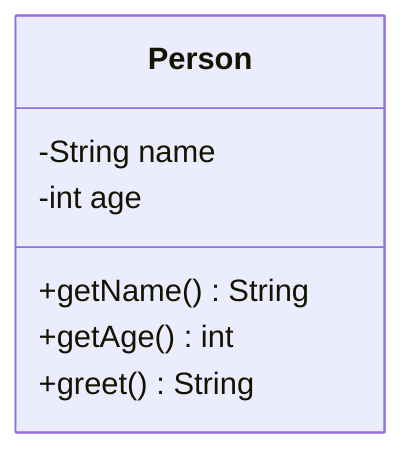

# UML y su Relación con la POO

**UML** (Unified Modeling Language, *Lenguaje Unificado de Modelado*) es un lenguaje visual estándar para especificar, visualizar y documentar sistemas software. No es un lenguaje de programación: es un **lenguaje de diseño** que te permite pensar antes de escribir código.



---

## ¿Qué problema resuelve UML?

Construir software sin planos previos es como construir un edificio sin arquitecto. Antes de escribir una sola línea de código, necesitamos responder:

- ¿Qué clases existirán en el sistema?
- ¿Qué datos almacenará cada clase?
- ¿Cómo se relacionan las clases entre sí?

UML proporciona una notación estándar para responder a estas preguntas de forma visual y comprensible por todo el equipo, independientemente del lenguaje de programación que se vaya a usar.

---

## Historia y origen de UML

UML nació en los años 90 de la fusión de tres metodologías de modelado orientado a objetos:

| Metodología | Autor(es) | Aportación clave |
|-------------|-----------|-----------------|
| **OMT** | James Rumbaugh | Diagramas de clases y objetos |
| **OOSE** | Ivar Jacobson | Casos de uso |
| **Booch** | Grady Booch | Notación de clases y relaciones |

En 1997, el **Object Management Group (OMG)** estandarizó UML como norma internacional. Actualmente se usa UML 2.x.

---

## Tipos de diagramas UML

UML define más de una docena de tipos de diagramas, divididos en dos grandes grupos:

### Diagramas estructurales (qué existe)

| Diagrama | ¿Para qué sirve? |
|----------|-----------------|
| **Diagrama de clases** | Muestra clases, atributos, métodos y relaciones |
| Diagrama de objetos | Muestra instancias concretas de clases en un momento dado |
| Diagrama de componentes | Organiza el código en módulos desplegables |
| Diagrama de despliegue | Muestra la infraestructura física del sistema |

### Diagramas de comportamiento (qué hace)

| Diagrama | ¿Para qué sirve? |
|----------|-----------------|
| **Diagrama de casos de uso** | Describe interacciones entre actores y el sistema |
| Diagrama de secuencia | Muestra el orden de mensajes entre objetos |
| Diagrama de actividad | Representa flujos de trabajo (similar a un diagrama de flujo) |
| Diagrama de estados | Modela los estados por los que pasa un objeto |

:::info
En este tema nos centraremos en el **diagrama de clases**, que es el más utilizado y el que tiene correspondencia directa con el código Java.
:::

---

## La relación directa entre UML y POO

El diagrama de clases de UML y la POO hablan el mismo idioma. Cada concepto de POO tiene su representación directa en UML:

| Concepto POO | Representación en UML | Código Java |
|---|---|---|
| **Clase** | Rectángulo con tres compartimentos | `public class Car { }` |
| **Atributo** | Línea en el compartimento central | `private String brand;` |
| **Método** | Línea en el compartimento inferior | `public void accelerate() { }` |
| **Herencia** | Flecha con punta triangular hueca | `class Car extends Vehicle` |
| **Interfaz/Realización** | Flecha discontinua con punta triangular | `class Car implements Drivable` |
| **Asociación** | Línea simple entre clases | Un `Driver` conduce un `Car` |
| **Composición** | Línea con rombo relleno | Un `Car` contiene un `Engine` |
| **Agregación** | Línea con rombo hueco | Un `Team` tiene `Players` |

---

## UML como puente entre análisis y código

El flujo de trabajo habitual en un proyecto orientado a objetos es:



:::tip
El diagrama de clases UML actúa como **contrato** entre el analista y el desarrollador. El analista define qué clases existen y cómo se relacionan; el desarrollador las implementa en el lenguaje elegido.
:::

---

## Del diagrama al código: primer ejemplo

Dado el siguiente diagrama UML de la clase `Person`:



La traducción directa a Java es:

```java
public class Person {
    private String name;  // - indica visibilidad privada
    private int age;

    public Person(String name, int age) {
        this.name = name;
        this.age = age;
    }

    public String getName() {   // + indica visibilidad pública
        return name;
    }

    public int getAge() {
        return age;
    }

    public String greet() {
        return "Hola, soy " + name + " y tengo " + age + " años.";
    }
}
```

La correspondencia es uno a uno: cada elemento del diagrama se convierte en código Java de forma mecánica.

---

## ¿Por qué modelar antes de codificar?

- **Detectar errores de diseño pronto**: cambiar una línea en un diagrama cuesta segundos; refactorizar cientos de líneas de código cuesta horas.
- **Comunicación del equipo**: un diagrama UML es comprensible para desarrolladores, analistas y, a veces, para el propio cliente.
- **Documentación viva**: el diagrama sirve de referencia durante todo el ciclo de vida del proyecto.
- **Independencia del lenguaje**: el mismo diagrama de clases puede implementarse en Java, C# o Python.

---

## Archivos relacionados

- [a-introduccion-poo.md](a-introduccion-poo.md) — Introducción a la POO
- [c-clases-y-objetos-uml.md](c-clases-y-objetos-uml.md) — Clases y objetos en UML
- [d-atributos-y-metodos.md](d-atributos-y-metodos.md) — Atributos y métodos en el diagrama de clases
- [e-relaciones-asociacion.md](e-relaciones-asociacion.md) — Relaciones: asociación, agregación y composición
- [f-herencia-y-realizacion.md](f-herencia-y-realizacion.md) — Herencia y realización en UML
