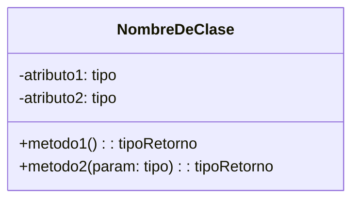
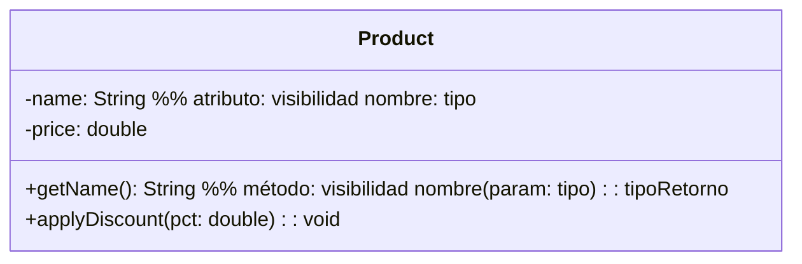
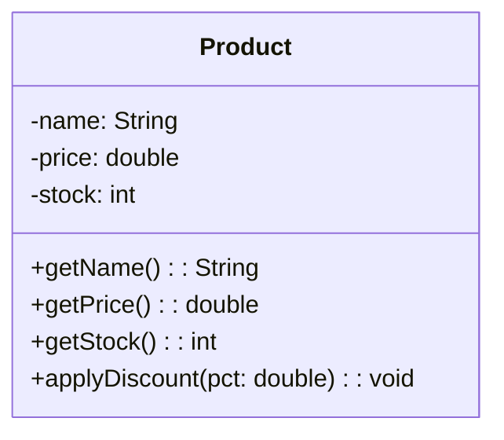
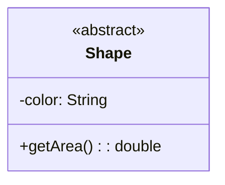
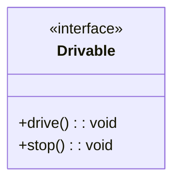

# Clases y Objetos en UML

Una **clase** en UML es el molde que define la estructura y el comportamiento de un conjunto de objetos. Un **objeto** es una instancia concreta de esa clase: ocupa memoria, tiene valores reales en sus atributos y puede ejecutar los métodos definidos por su clase.

```java
// La clase es el molde
public class Dog {
    private String name;
    private String breed;

    public Dog(String name, String breed) {
        this.name = name;
        this.breed = breed;
    }

    public String getName() { return name; }
    public String getBreed() { return breed; }
}

// Los objetos son instancias concretas
Dog rex   = new Dog("Rex",   "Pastor Alemán");
Dog buddy = new Dog("Buddy", "Golden Retriever");
```

---

## La notación de clase en UML

En un diagrama de clases, una clase se representa con un **rectángulo dividido en tres compartimentos**: nombre (arriba), atributos (centro) y métodos (abajo).



- El **nombre** de la clase siempre empieza en mayúscula y está centrado (negrita en muchas herramientas).
- Los **atributos** se listan con su tipo separado por dos puntos.
- Los **métodos** se listan con sus parámetros y tipo de retorno.

:::info
**Guía Mermaid: cómo se escribe una clase**

Todo diagrama de clases en Mermaid empieza con `classDiagram`. Cada clase se declara con `class Nombre { ... }` y dentro de las llaves se escribe **un miembro por línea**: primero el símbolo de visibilidad y después el nombre y el tipo separados por dos puntos (atributos) o el nombre con los parámetros entre paréntesis y el tipo de retorno tras dos puntos (métodos).

````text

````

- Se escribe dentro de un bloque de código con la etiqueta `mermaid` (tres acentos graves + `mermaid`).
- Los comentarios empiezan por `%%`.
- Si una clase no tiene miembros, basta con `class Nombre`.
- Puedes comprobar tu diagrama al instante en el [editor online de Mermaid](https://mermaid.live).
:::

---

## Indicadores de visibilidad

El símbolo delante de cada atributo o método indica su **visibilidad**:

| Símbolo | Visibilidad | Palabra clave Java |
|---------|-------------|-------------------|
| `+` | Público | `public` |
| `-` | Privado | `private` |
| `#` | Protegido | `protected` |
| `~` | Paquete | *(sin modificador)* |

:::warning
Buena práctica: los atributos de una clase de modelo **siempre deben ser privados** (`-`). Accede a ellos únicamente a través de métodos públicos (`+`).
:::

---

## Ejemplo completo: clase Product

Diagrama UML:



Código Java equivalente:

```java
public class Product {
    private String name;
    private double price;
    private int stock;

    public Product(String name, double price, int stock) {
        this.name  = name;
        this.price = price;
        this.stock = stock;
    }

    public String getName()  { return name; }
    public double getPrice() { return price; }
    public int getStock()    { return stock; }

    public void applyDiscount(double pct) {
        price = price * (1 - pct / 100);
    }
}
```

---

## Diferencia entre clase y objeto

| | Clase | Objeto |
|--|-------|--------|
| **¿Qué es?** | Plantilla / molde | Instancia concreta |
| **¿Cuántas hay?** | Una por tipo | Tantas como se creen |
| **¿Ocupa memoria?** | No (es código) | Sí (en el heap) |
| **Ejemplo** | `Product` | `new Product("Laptop", 999.99, 5)` |

---

## Diagrama de objetos (snapshot)

Además del diagrama de clases, UML ofrece el **diagrama de objetos**, que muestra instancias concretas en un momento dado. Es útil para ilustrar escenarios de prueba o estados del sistema.

```
+-------------------------------+
|  laptop123 : Product          |   ← nombre_objeto : NombreClase
+-------------------------------+
|  name  = "Laptop Pro"         |   ← valores reales, no tipos
|  price = 999.99               |
|  stock = 5                    |
+-------------------------------+
```

La diferencia visual clave: el nombre va **subrayado** y los atributos muestran **valores**, no tipos.

:::note
Mermaid no dispone de un tipo de diagrama de objetos. En esta asignatura solo se te pedirán **diagramas de clases** (`classDiagram`).
:::

---

## Clases abstractas e interfaces en UML

Cuando una clase no puede ser instanciada directamente, se denomina **clase abstracta**. En UML se indica con el nombre en *cursiva* o con el estereotipo `«abstract»`.



Las **interfaces** se representan con el estereotipo `«interface»`:



```java
public interface Drivable {
    void drive();
    void stop();
}
```

:::info
**Guía Mermaid: estereotipos**

El estereotipo se escribe con `<<...>>` como **primera línea** dentro de las llaves de la clase: `<<abstract>>`, `<<interface>>` o `<<enumeration>>`.
:::

---

## Archivos relacionados

- [b-uml-y-poo.md](b-uml-y-poo.md) — UML y su relación con la POO
- [d-atributos-y-metodos.md](d-atributos-y-metodos.md) — Atributos y métodos en detalle
- [e-relaciones-asociacion.md](e-relaciones-asociacion.md) — Relaciones entre clases
