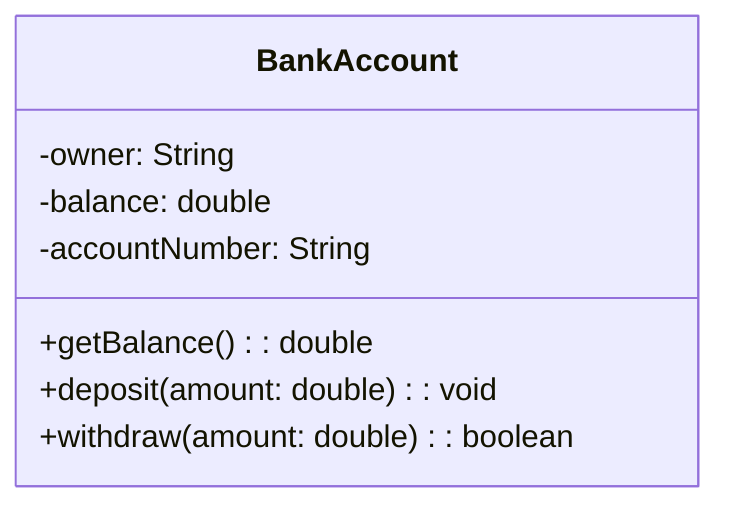
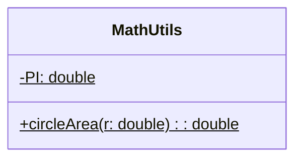
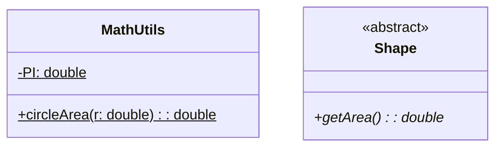
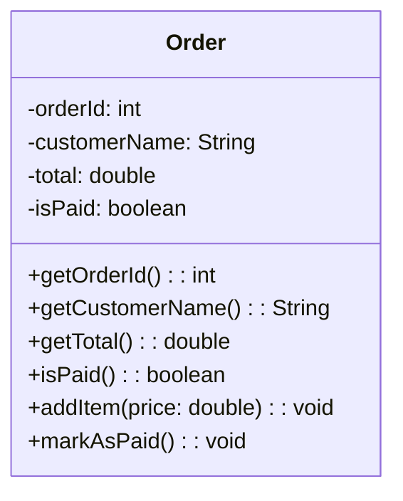

# Atributos y Métodos en el Diagrama de Clases

Los **atributos** describen el estado de un objeto (sus datos) y los **métodos** describen su comportamiento (lo que puede hacer). Saber representarlos correctamente en UML es fundamental para leer y escribir diagramas de clases profesionales.



---

## Sintaxis de un atributo en UML

La sintaxis completa de un atributo en UML es:

```
visibilidad nombre: tipo [multiplicidad] = valorPorDefecto
```

| Parte | Obligatoria | Ejemplo |
|-------|------------|---------|
| visibilidad | Sí | `-` (privado) |
| nombre | Sí | `balance` |
| tipo | Sí | `double` |
| multiplicidad | No | `[0..*]` (colección) |
| valorPorDefecto | No | `= 0.0` |

Ejemplo con todos los elementos:

```
-balance: double = 0.0
-tags: String[*]
```

---

## Sintaxis de un método en UML

La sintaxis completa de un método en UML es:

```
visibilidad nombre(param1: tipo1, param2: tipo2): tipoRetorno
```

Ejemplos:

```
+deposit(amount: double): void
+withdraw(amount: double): boolean
+getFullName(): String
+calculateInterest(rate: double, years: int): double
```

:::tip
Si un método no devuelve nada, el tipo de retorno es `void`. Si no tiene parámetros, los paréntesis van vacíos: `+getBalance(): double`.
:::

:::info
**Guía Mermaid: atributos y métodos**

En Mermaid se escribe un miembro por línea dentro de la clase, con este formato (el mismo que se usa en todo el curso):

```text
atributo:  [-|+|#]<nombre_atributo>: <tipo_atributo>
método:    [-|+|#]<nombre_funcion>(<nombre_parametro>: <tipo_parametro>): <tipo_retorno>
```

| Elemento | En Mermaid |
|----------|------------|
| Atributo | `-balance: double` |
| Método sin parámetros | `+getBalance(): double` |
| Método sin retorno | `+markAsPaid(): void` |
| Método con un parámetro | `+deposit(amount: double): void` |
| Método con varios parámetros | `+calculateInterest(rate: double, years: int): double` |
| Colección | `-items: List~Item~` |

Puntos a tener en cuenta:
- **No hay espacio antes de los dos puntos**: `-balance: double`, no `-balance : double`.
- Los parámetros también llevan `nombre: tipo`, separados por comas.
- El **tipo de retorno** va siempre tras `): `, incluso `void`.
- Los **genéricos** se escriben con tildes `~` en lugar de `< >`: `List~Item~` equivale a `List<Item>`.
:::

---

## Atributos estáticos y métodos estáticos

Los miembros **estáticos** pertenecen a la clase, no a cada objeto. En UML se representan **subrayados** (en Mermaid se indica con el sufijo `$`).



```java
public class MathUtils {
    private static final double PI = 3.14159;

    public static double circleArea(double r) {
        return PI * r * r;
    }
}

// Se llama sin instanciar la clase:
double area = MathUtils.circleArea(5.0);
```

:::info
**Guía Mermaid: estático y abstracto**

Se añade un sufijo al final de la línea del miembro: `$` para **estático** y `*` para **abstracto**.

````text

````
:::

---

## Traducción de tipos UML ↔ Java

| Tipo UML | Tipo Java | Notas |
|----------|-----------|-------|
| `String` | `String` | Igual |
| `int` | `int` | Tipo primitivo |
| `double` | `double` | Tipo primitivo |
| `boolean` | `boolean` | Tipo primitivo |
| `Date` | `LocalDate` | Usar la API moderna |
| `List<T>` | `List<T>` | `java.util.List` |
| `void` | `void` | Sin retorno |

---

## Ejemplo completo: clase Order

Diagrama UML:



Código Java:

```java
public class Order {
    private int orderId;
    private String customerName;
    private double total = 0.0;
    private boolean isPaid = false;

    public Order(int orderId, String customerName) {
        this.orderId      = orderId;
        this.customerName = customerName;
    }

    public int getOrderId()          { return orderId; }
    public String getCustomerName()  { return customerName; }
    public double getTotal()         { return total; }
    public boolean isPaid()          { return isPaid; }

    public void addItem(double price) {
        if (price > 0) {
            total += price;
        }
    }

    public void markAsPaid() {
        isPaid = true;
    }
}
```

---

## Getters, setters y encapsulación

Una convención habitual es proporcionar:
- Un **getter** (`getNombre()`) para leer un atributo privado.
- Un **setter** (`setNombre(valor)`) para modificarlo, solo cuando sea necesario.

:::warning
No todos los atributos necesitan setter. Un `orderId` asignado en el constructor no debería poder cambiarse después. Añadir setters innecesarios rompe la encapsulación.
:::

```java
// Solo tiene getter, no setter: el id es inmutable tras la creación
public int getOrderId() {
    return orderId;
}
```

---

## Archivos relacionados

- [c-clases-y-objetos-uml.md](c-clases-y-objetos-uml.md) — Clases y objetos en UML
- [e-relaciones-asociacion.md](e-relaciones-asociacion.md) — Relaciones entre clases
