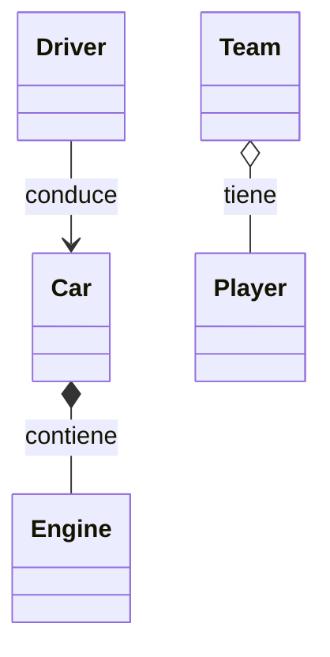
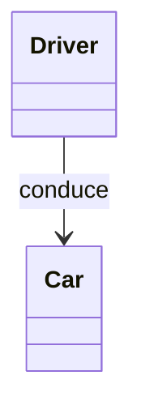
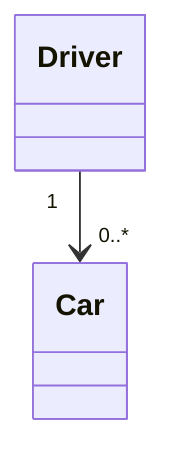
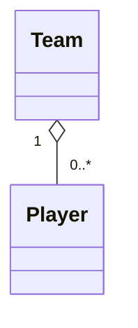
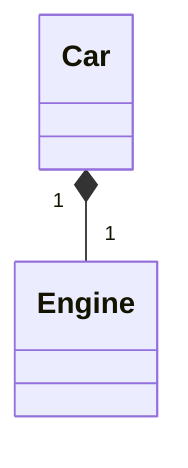

# Relaciones: Asociación, Agregación y Composición

Las clases rara vez existen de forma aislada. Las **relaciones** en UML modelan cómo las clases se conectan entre sí. Hay tres tipos de relaciones estructurales: **asociación**, **agregación** y **composición**.



---

## Asociación

Una **asociación** representa que dos clases se conocen y pueden interactuar. Es la relación más general: un objeto de una clase mantiene una referencia a un objeto de otra clase.

### Notación UML



- Línea simple entre las dos clases.
- Opcionalmente: nombre de la relación y dirección con una flecha abierta.
- Se puede indicar la **multiplicidad** en cada extremo.

### Multiplicidades

| Notación | Significado |
|----------|-------------|
| `1` | Exactamente uno |
| `0..1` | Cero o uno (opcional) |
| `*` o `0..*` | Cero o más |
| `1..*` | Uno o más |
| `2..5` | Entre dos y cinco |

Ejemplo con multiplicidades:



*Un conductor puede tener cero o más coches; cada coche pertenece exactamente a un conductor.*

### Código Java

```java
public class Driver {
    private String name;
    private Car car; // referencia a otro objeto: asociación

    public Driver(String name) {
        this.name = name;
    }

    public void assignCar(Car car) {
        this.car = car;
    }

    public Car getCar() {
        return car;
    }

    public String getName() {
        return name;
    }
}

public class Car {
    private String brand;

    public Car(String brand) {
        this.brand = brand;
    }

    public String getBrand() {
        return brand;
    }
}
```

---

## Agregación

La **agregación** es una asociación especial que expresa una relación **"todo – parte"** débil: el todo contiene las partes, pero las partes pueden existir de forma independiente al todo.

Analogía: un **equipo de fútbol** y sus **jugadores**. Si el equipo se disuelve, los jugadores siguen existiendo y pueden fichar por otro equipo.

### Notación UML



El **rombo hueco** (`◇`) está en el lado del "todo" (Team).

### Código Java

```java
import java.util.ArrayList;
import java.util.List;

public class Team {
    private String teamName;
    private List<Player> players; // los Player se crean fuera y se añaden

    public Team(String teamName) {
        this.teamName = teamName;
        this.players  = new ArrayList<>();
    }

    public void addPlayer(Player player) {
        players.add(player);
    }

    public String getTeamName() {
        return teamName;
    }

    public List<Player> getPlayers() {
        return players;
    }
}

public class Player {
    private String name;

    public Player(String name) {
        this.name = name;
    }

    public String getName() {
        return name;
    }
}
```

```java
// Los Player se crean independientemente del Team
Player p1 = new Player("Messi");
Player p2 = new Player("Xavi");

Team team = new Team("FC Barcelona");
team.addPlayer(p1);
team.addPlayer(p2);
// Si team deja de existir, p1 y p2 siguen vivos
```

---

## Composición

La **composición** es una relación **"todo – parte"** fuerte: las partes son creadas y destruidas por el todo, y no tienen sentido fuera de él.

Analogía: un **coche** y su **motor**. El motor se crea cuando se fabrica el coche y deja de tener sentido si el coche es desguazado.

### Notación UML



El **rombo relleno** (`◆`) está en el lado del "todo" (Car).

### Código Java

```java
public class Engine {
    private int horsepower;

    public Engine(int horsepower) {
        this.horsepower = horsepower;
    }

    public int getHorsepower() {
        return horsepower;
    }
}

public class Car {
    private String brand;
    private Engine engine; // composición: Car crea y posee Engine

    public Car(String brand, int hp) {
        this.brand  = brand;
        this.engine = new Engine(hp); // Engine se crea DENTRO de Car
    }

    public String getBrand()    { return brand; }
    public Engine getEngine()   { return engine; }
}
```

```java
Car car = new Car("Toyota", 150);
// Engine existe solo porque Car existe
// Si car es destruido, engine también lo es
```

---

## Tabla comparativa de las tres relaciones

| Relación | Símbolo UML | Dependencia de vida | Ejemplo |
|----------|------------|---------------------|---------|
| **Asociación** | Línea simple `──` | Independiente | Conductor – Coche |
| **Agregación** | Rombo hueco `◇──` | Partes sobreviven al todo | Equipo – Jugadores |
| **Composición** | Rombo relleno `◆──` | Partes mueren con el todo | Coche – Motor |

:::tip Para decidir qué relación usar: pregúntate si las partes tienen sentido fuera del todo. Si no → composición. Si sí, pero forman un conjunto → agregación. Si simplemente se conocen → asociación.
:::

---

## Archivos relacionados

- [d-atributos-y-metodos.md](d-atributos-y-metodos.md) — Atributos y métodos
- [f-herencia-y-realizacion.md](f-herencia-y-realizacion.md) — Herencia y realización en UML
