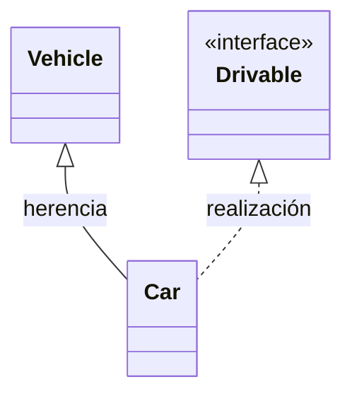
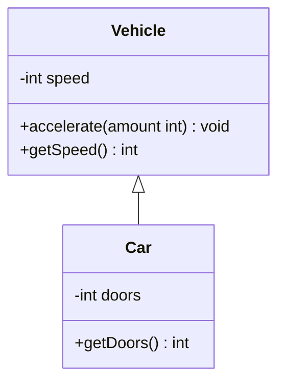
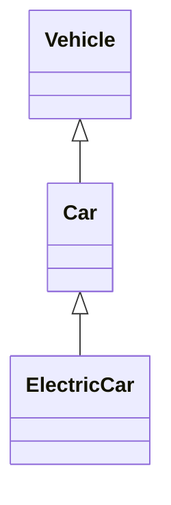
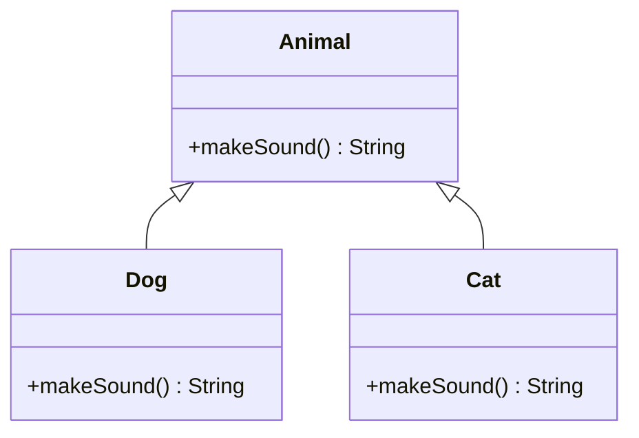
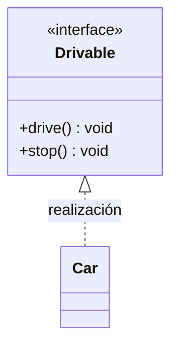

# Herencia y Realización en UML

La **herencia** y la **realización** son las relaciones que modelan la jerarquía de tipos en la POO. La herencia conecta clases entre sí; la realización conecta clases con interfaces.



---

## Herencia (Generalización)

En UML, la **herencia** se denomina también **generalización**: la clase padre es más general, y la clase hija es más específica.

Una clase hija:
- **Hereda** todos los atributos y métodos no privados del padre.
- Puede **sobreescribir** (`@Override`) métodos del padre para cambiar su comportamiento.
- Puede **añadir** atributos y métodos propios.

### Notación UML



La **flecha con punta triangular hueca** apunta siempre hacia la clase padre.

### Código Java

```java
public class Vehicle {
    private int speed;

    public void accelerate(int amount) {
        speed += amount;
    }

    public int getSpeed() {
        return speed;
    }
}

public class Car extends Vehicle {
    private int doors;

    public Car(int doors) {
        this.doors = doors;
    }

    public int getDoors() {
        return doors;
    }
}
```

```java
Car car = new Car(4);
car.accelerate(60);             // heredado de Vehicle
System.out.println(car.getSpeed()); // 60
System.out.println(car.getDoors()); // 4
```

---

## Jerarquía de herencia multinivel

La herencia puede encadenarse en varios niveles:



```java
public class ElectricCar extends Car {
    private int batteryCapacity; // kWh

    public ElectricCar(int doors, int batteryCapacity) {
        super(doors);
        this.batteryCapacity = batteryCapacity;
    }

    public int getBatteryCapacity() {
        return batteryCapacity;
    }
}
```

:::warning Java solo permite **herencia simple**: una clase puede extender únicamente a una clase padre. Para reutilizar comportamiento de múltiples fuentes, se usan **interfaces**.
:::

---

## Sobreescritura de métodos (polimorfismo)

Cuando una clase hija redefine un método del padre, se produce **sobreescritura**. En UML se representa indicando el mismo nombre de método en la clase hija:



```java
public class Animal {
    public String makeSound() {
        return "...";
    }
}

public class Dog extends Animal {
    @Override
    public String makeSound() {
        return "Woof!";
    }
}

public class Cat extends Animal {
    @Override
    public String makeSound() {
        return "Meow!";
    }
}
```

```java
// Polimorfismo en acción: el tipo estático es Animal
Animal[] animals = { new Dog(), new Cat(), new Dog() };
for (Animal a : animals) {
    System.out.println(a.makeSound()); // Woof! / Meow! / Woof!
}
```

---

## Realización (implementación de interfaces)

La **realización** expresa que una clase se compromete a implementar el contrato definido por una interfaz.

### Notación UML



La **línea discontinua con punta triangular hueca** apunta siempre hacia la interfaz.

### Código Java

```java
public interface Drivable {
    void drive();
    void stop();
}

public class Car extends Vehicle implements Drivable {
    private int doors;

    public Car(int doors) {
        this.doors = doors;
    }

    @Override
    public void drive() {
        accelerate(30);
    }

    @Override
    public void stop() {
        // lógica de frenado
    }

    public int getDoors() {
        return doors;
    }
}
```

:::tip Una clase puede implementar **múltiples interfaces** al mismo tiempo, lo que resuelve la limitación de la herencia simple en Java:

```java
public class Car extends Vehicle implements Drivable, Insurable { ... }
```
:::

---

## Tabla comparativa: herencia vs. realización

| | Herencia | Realización |
|--|----------|------------|
| **Símbolo UML** | Línea continua + punta hueca `──▷` | Línea discontinua + punta hueca `╌╌▷` |
| **Palabra clave Java** | `extends` | `implements` |
| **¿Qué conecta?** | Clase → Clase | Clase → Interfaz |
| **¿Hereda implementación?** | Sí | No (solo el contrato) |
| **Límite** | Solo una clase padre | Múltiples interfaces |

---

## Archivos relacionados

- [e-relaciones-asociacion.md](e-relaciones-asociacion.md) — Asociación, agregación y composición
- [g-errores-comunes.md](g-errores-comunes.md) — Errores comunes
