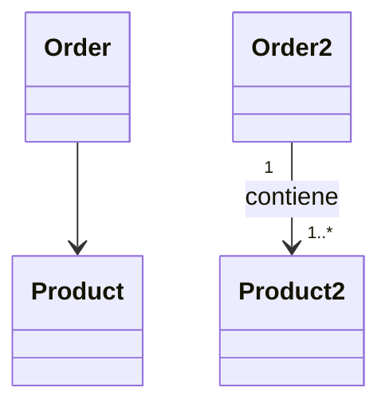
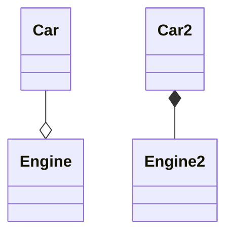

# Errores Comunes con Diagramas de Clase UML y POO

---

## Error 1: Atributos públicos en la clase

Declarar atributos como `public` viola la encapsulación y expone el estado interno del objeto sin ningún control.

```java
// Incorrecto:
public class Person {
    public String name;   // cualquiera puede modificarlo sin restricciones
    public int age;
}

// Correcto:
public class Person {
    private String name;
    private int age;

    public String getName() { return name; }
    public int getAge()     { return age; }
}
```

En UML, los atributos públicos se representan con `+`, lo que es una señal de alerta en una clase de modelo. **Siempre usa `-` para los atributos**.

---

## Error 2: Confundir asociación con composición

Usar composición cuando la relación es solo una asociación hace que objetos independientes queden ligados artificialmente al ciclo de vida de otro.

```java
// Incorrecto (composición forzada):
// Un Driver crea su propio Car dentro del constructor.
// ¿Qué pasa si el conductor quiere cambiar de coche?
public class Driver {
    private Car car;

    public Driver(String name) {
        this.car = new Car("Toyota"); // Car no puede existir sin este Driver
    }
}

// Correcto (asociación):
public class Driver {
    private String name;
    private Car car;

    public Driver(String name) {
        this.name = name;
    }

    public void assignCar(Car car) { // Car se crea fuera y se asocia
        this.car = car;
    }
}
```

En el diagrama UML, usa `──>` (asociación) si los objetos se crean de forma independiente, y `◆──` (composición) solo si la parte no tiene sentido fuera del todo.

---

## Error 3: Herencia donde debería haber composición

Extender una clase para reutilizar métodos cuando no existe una relación "es-un" es un error clásico. Si `Stack` extiende `ArrayList`, un `Stack` **es-un** `ArrayList`, lo cual permite operaciones como `add(index, element)` que rompen la semántica de una pila.

```java
// Incorrecto: Stack hereda de ArrayList solo para reutilizar métodos
public class Stack extends ArrayList<Integer> {
    public void push(int value) { add(value); }
    public int pop()            { return remove(size() - 1); }
    // Problema: alguien puede llamar a add(0, 99) y corromper la pila
}

// Correcto: Stack usa composición
public class Stack {
    private ArrayList<Integer> items = new ArrayList<>();

    public void push(int value)  { items.add(value); }
    public int pop()             { return items.remove(items.size() - 1); }
    public boolean isEmpty()     { return items.isEmpty(); }
}
```

Regla: usa herencia solo cuando puedas decir "B **es un tipo de** A". Si solo quieres reutilizar código, usa composición.

---

## Error 4: Olvidar las multiplicidades en el diagrama

Un diagrama sin multiplicidades es ambiguo: no queda claro si un `Order` puede tener uno o varios `Product`.



Añade siempre las multiplicidades en los extremos de cada relación.

---

## Error 5: Implementar una interfaz sin cubrir todos sus métodos

Si una clase declara `implements` pero no implementa todos los métodos de la interfaz, el código no compilará.

```java
public interface Shape {
    double getArea();
    double getPerimeter();
}

// Incorrecto: falta implementar getPerimeter()
public class Circle implements Shape {
    private double radius;

    public Circle(double radius) { this.radius = radius; }

    @Override
    public double getArea() {
        return Math.PI * radius * radius;
    }
    // Error de compilación: getPerimeter() no está implementado
}

// Correcto:
public class Circle implements Shape {
    private double radius;

    public Circle(double radius) { this.radius = radius; }

    @Override
    public double getArea() {
        return Math.PI * radius * radius;
    }

    @Override
    public double getPerimeter() {
        return 2 * Math.PI * radius;
    }
}
```

En el diagrama UML, la realización (`◁╌╌`) implica que la clase debe implementar **todos** los métodos de la interfaz.

---

## Error 6: Rombo de agregación/composición en el lado equivocado

El rombo siempre va en el lado del **todo**, no de la parte.



Pregúntate: ¿quién contiene a quién? El rombo va en el contenedor.

---

## Error 7: Usar herencia multinivel excesiva

Más de tres niveles de herencia generan jerarquías frágiles: un cambio en la clase raíz puede romper todas las subclases.

```java
// Problemático: jerarquía de 5 niveles
// Animal → Vertebrate → Mammal → Pet → Dog → Labrador

// Preferible: mantener la jerarquía plana y usar interfaces para comportamiento
public class Dog extends Animal implements Trainable, Domestic { }
```

En el diagrama UML, si ves más de 3 niveles de flecha de herencia encadenados, plantéate si la jerarquía es necesaria o si la composición/interfaces serían más adecuadas.

---

## Errores de sintaxis habituales en Mermaid

Si tu diagrama no se dibuja o sale distinto de lo esperado, revisa esta lista:

| Error | Incorrecto | Correcto |
|-------|-----------|----------|
| Olvidar la primera línea | `class Car { ... }` | `classDiagram` y después las clases |
| Genéricos con `< >` | `List<Order> orders` | `List~Order~ orders` |
| Formato distinto al del curso | `-String name`, `+getName() String` | `-name: String`, `+getName(): String` |
| Multiplicidad sin comillas | `A 1 --> 0..* B` | `A "1" --> "0..*" B` |
| Estereotipo fuera de la clase | `<<interface>> Drivable` | `class Drivable { <<interface>> }` |
| Rombo en la parte | `Engine *-- Car` | `Car *-- Engine` |

:::tip
Ante cualquier duda, pega el código en el [editor online de Mermaid](https://mermaid.live): te marca la línea que falla.
:::
