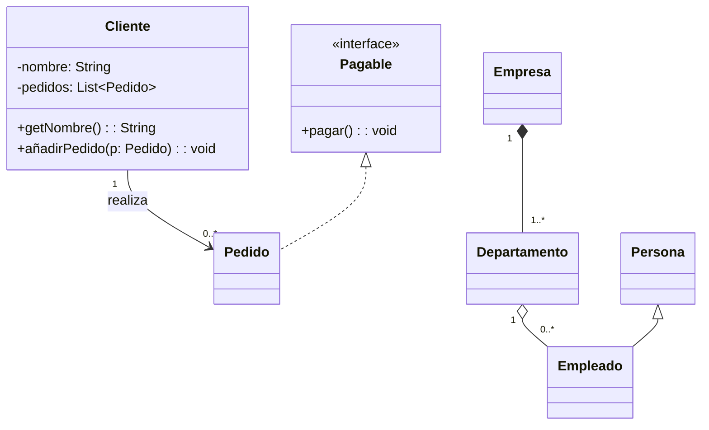

# Ejercicios — Tema 3: Diagramas de Clase UML y POO

---

En esta sección encontrarás los ejercicios propuestos para el Tema 3.

:::info
**Ejercicios de diseño, no de programación**

Todavía no sabes programar en Java, así que **no hace falta escribir código**. En cada ejercicio debes dibujar el **diagrama de clases UML**: clases, atributos, métodos y relaciones (con su tipo y multiplicidad). Los diagramas deben entregarse **obligatoriamente en Mermaid** (bloques de código `mermaid` con `classDiagram`).
:::

## Chuleta de sintaxis Mermaid

````text

````

| Quiero escribir... | Mermaid |
|--------------------|---------|
| Visibilidad | `+` público, `-` privado, `#` protegido, `~` paquete |
| Atributo | `-nombre: String` |
| Método | `+getNombre(): String` |
| Método con parámetros | `+añadirPedido(p: Pedido): void` |
| Lista de objetos | `-pedidos: List~Pedido~` |
| Interfaz / abstracta | `<<interface>>` / `<<abstract>>` (primera línea de la clase) |
| Asociación | `A --> B` |
| Agregación | `Todo o-- Parte` |
| Composición | `Todo *-- Parte` |
| Herencia | `Padre <\|-- Hija` |
| Realización | `Interfaz <\|.. Clase` |
| Multiplicidad | `A "1" --> "0..*" B` |
| Etiqueta | `A --> B : texto` |

Los detalles de cada elemento están en los apartados anteriores: [clases](c-clases-y-objetos-uml.md), [atributos y métodos](d-atributos-y-metodos.md), [relaciones](e-relaciones-asociacion.md) y [herencia y realización](f-herencia-y-realizacion.md).

---

## Ejercicios

### Ejercicio 1 — Biblioteca

Diseña el diagrama de clases UML de un sistema de biblioteca. El sistema debe modelar:

- Un **libro** con título, autor, ISBN y año de publicación.
- Un **socio** con nombre, número de socio y fecha de alta.
- Un **préstamo** que relaciona un socio con un libro, con fecha de préstamo y fecha de devolución prevista.

Restricciones:
- Un socio puede tener varios préstamos activos; un libro solo puede estar prestado a un socio a la vez.
- La clase `Library` gestiona el alta de socios y libros, y el registro de préstamos.

---

### Ejercicio 2 — Figuras Geométricas

Diseña el diagrama de clases de una jerarquía de figuras geométricas:

- Interfaz `Shape` con métodos `getArea()` y `getPerimeter()`.
- Clases concretas: `Circle`, `Rectangle` y `Triangle`, cada una realizando (implementando) `Shape`.
- Clase `ShapeCalculator` con un método que recibe una lista de `Shape` y devuelve la suma total de áreas.

Restricciones:
- Aprovecha el polimorfismo: `ShapeCalculator` solo debe relacionarse con la interfaz `Shape`, no con las clases concretas.

---

### Ejercicio 3 — Empresa y Empleados

Diseña el diagrama de clases de la estructura de una empresa:

- Una **empresa** tiene un nombre y una lista de **departamentos**.
- Cada **departamento** tiene un nombre y una lista de **empleados**.
- Un **empleado** tiene nombre, puesto y salario.
- La empresa tiene un método que devuelve el empleado con el salario más alto.
- Un departamento tiene un método que devuelve la suma de salarios de sus empleados.

Restricciones:
- Usa composición entre `Company` y `Department` (los departamentos no existen fuera de la empresa).
- Usa agregación entre `Department` y `Employee` (los empleados pueden existir independientemente).

---

### Ejercicio 4 — Carrito de la Compra

Diseña el diagrama de clases de un sistema básico de carrito de compra:

- Un **producto** tiene nombre, precio y categoría.
- Un **carrito** contiene una lista de productos y permite añadir, eliminar y calcular el total.
- Un **descuento** es una interfaz con un método `apply(double total): double`. Incluye dos descuentos: porcentaje fijo (`PercentageDiscount`) y descuento de cantidad fija (`FixedDiscount`).
- El carrito acepta un `Discount` opcional y lo aplica al calcular el total.

Restricciones:
- El carrito debe relacionarse con la interfaz `Discount`, no con una implementación concreta de descuento.

---

### Ejercicio 5 — Hotel Retro Games

En una ciudad japonesa se ha inaugurado un **Hotel Retro Games**, un hotel temático basado en los videojuegos clásicos. Diseña el diagrama de clases del sistema que lo gestiona.

**Hotel**

Cada hotel tiene un nombre, una dirección y una categoría (3, 4 o 5 estrellas). Además, cuenta con habitaciones y con un catálogo de consolas retro disponibles para alquilar.

**Habitaciones**

Cada habitación tiene un número o identificador, un precio por noche, un estado (libre u ocupada) y un tipo: Básica, Arcade, Premium o Retro Gamer.

**Consolas retro**

El hotel tiene un inventario de consolas. Cada consola se caracteriza por un código, un nombre, una marca (Nintendo, Sega, Sony, etc.) y su año de lanzamiento.

Puede haber varias unidades de la misma consola. Cada unidad concreta se distingue por un identificador único y la fecha en la que fue adquirida.

**Consolas especiales**

Existe un tipo especial de consola: la **consola de edición limitada**. Puede alquilarse en cualquier tipo de habitación, pero las habitaciones Retro Gamer solo pueden tener consolas de edición limitada.

**Gestión del hotel**

El sistema debe permitir las siguientes operaciones sobre el hotel:
- Mover una consola de una habitación a otra. Devuelve si la operación se ha podido realizar (`true` o `false`).
- Comprar una nueva consola. Devuelve la consola comprada.
- Eliminar una consola del inventario.

**Clientes**

El hotel también gestiona clientes. Cada cliente tiene un nombre, un DNI y una fecha de nacimiento. El hotel debe poder:
- Registrar nuevos clientes.
- Consultar en qué habitaciones se ha alojado cada cliente en el pasado.

Restricciones:
- Indica en el diagrama los atributos, los métodos (con sus parámetros y tipo de retorno) y las multiplicidades de cada relación.
- Elige y justifica el tipo de relación (asociación, agregación, composición, herencia) entre cada par de clases.
