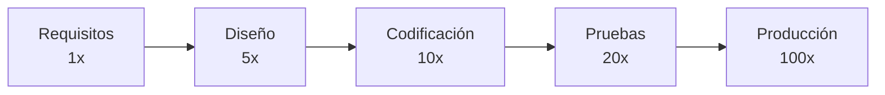
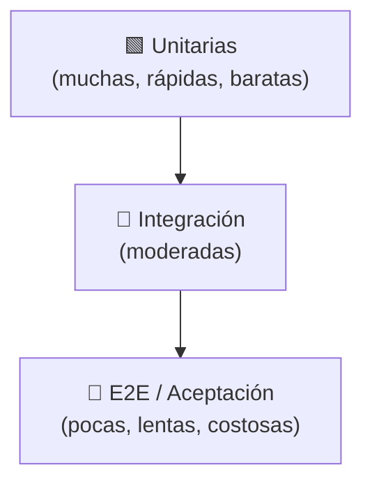

# Introducción a las Pruebas de Software

Las **pruebas de software** son el proceso de verificar que un programa se comporta como se espera. Su objetivo es encontrar errores antes de que lleguen al usuario final, no demostrar que el software es perfecto.

```java
// Una prueba comprueba que un método devuelve el resultado esperado
@Test
void totalWithTwoItems_returnsCorrectSum() {
    ShoppingCart cart = new ShoppingCart();
    cart.addItem(10.0);
    cart.addItem(5.0);
    assertEquals(15.0, cart.getTotal());
}
```

---

## ¿Por qué probar el software?

Imagina construir un puente y no comprobar la resistencia de ninguna viga antes de abrirlo al tráfico. En el software, cada función no probada es una viga sin revisar.

El coste de corregir un error crece exponencialmente cuanto más tarde se detecta:



*Coste relativo de corregir un error según la fase en que se detecta.*

Probar el software permite:

- **Detectar errores pronto**, cuando son baratos de corregir.
- **Documentar el comportamiento esperado** del código de forma ejecutable.
- **Refactorizar con seguridad**: si las pruebas siguen pasando, el comportamiento se ha preservado.
- **Aumentar la confianza** del equipo al desplegar cambios.

---

## El ciclo de vida de una prueba

Una prueba bien escrita sigue el patrón **AAA** (Arrange – Act – Assert):

| Fase | ¿Qué hace? | Ejemplo |
|------|-----------|---------|
| **Arrange** | Prepara el contexto: crea objetos y datos de entrada | `ShoppingCart cart = new ShoppingCart();` |
| **Act** | Ejecuta la acción que se quiere probar | `cart.addItem(10.0);` |
| **Assert** | Verifica que el resultado es el esperado | `assertEquals(10.0, cart.getTotal());` |

```java
@Test
void applyDiscount_reducesTotalCorrectly() {
    // Arrange
    ShoppingCart cart = new ShoppingCart();
    cart.addItem(100.0);

    // Act
    cart.applyDiscount(10); // 10 % de descuento

    // Assert
    assertEquals(90.0, cart.getTotal());
}
```

---

## La pirámide de pruebas

No todas las pruebas son iguales. La **pirámide de pruebas** describe la proporción recomendada de cada tipo:



- La **base** son las pruebas **unitarias**: rápidas, aisladas, baratas. Deben ser la mayoría.
- El **centro** son las pruebas de **integración**: verifican que los módulos funcionan juntos.
- La **cima** son las pruebas **end-to-end**: simulan al usuario real, son lentas y frágiles.

:::tip En este tema nos centraremos en las **pruebas unitarias**, que son la base de cualquier estrategia de calidad y la habilidad más demandada en el mercado laboral.
:::

---

## Conceptos clave del tema

| Concepto | Descripción |
|---------|-------------|
| **Prueba unitaria** | Verifica una unidad de código (método o clase) de forma aislada |
| **JUnit 5** | Framework estándar de pruebas unitarias en Java |
| **Mock** | Objeto simulado que sustituye a una dependencia real en una prueba |
| **Cobertura de código** | Porcentaje del código que es ejecutado por las pruebas |
| **CI/CD** | Pipeline automatizado que ejecuta las pruebas en cada cambio del código |
| **TDD** | Test-Driven Development: escribir la prueba antes que el código |

---

## Archivos relacionados

- [b-tipos-de-pruebas.md](b-tipos-de-pruebas.md) — Tipos de pruebas de software
- [c-pruebas-unitarias.md](c-pruebas-unitarias.md) — Pruebas unitarias: concepto y estructura
- [d-junit5.md](d-junit5.md) — JUnit 5: el framework estándar en Java
- [e-mocks-y-stubs.md](e-mocks-y-stubs.md) — Mocks, stubs y dependencias
- [f-cobertura-de-codigo.md](f-cobertura-de-codigo.md) — Cobertura de código
- [g-cicd.md](g-cicd.md) — CI/CD y su relación con las pruebas
- [h-errores-comunes.md](h-errores-comunes.md) — Errores comunes
- [i-ejercicios-y-soluciones.md](i-ejercicios-y-soluciones.md) — Ejercicios y soluciones
