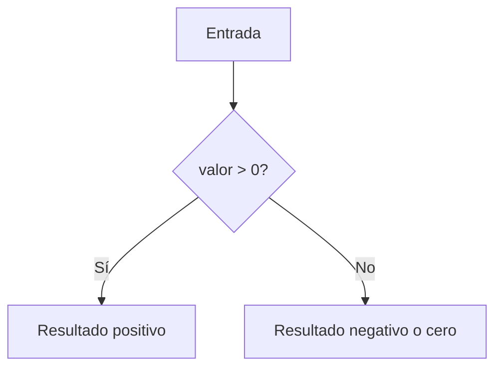

# Tipos de Pruebas de Software

Las pruebas de software se clasifican según el **nivel de abstracción** que verifican y el **objetivo** que persiguen. Conocer las diferencias permite decidir qué tipo de prueba aplicar en cada situación.

---

## Clasificación por nivel

### Pruebas unitarias

Una **prueba unitaria** verifica el comportamiento de una única unidad de código — normalmente un método o una clase — de forma completamente aislada de sus dependencias.

```java
// Prueba unitaria: solo interviene la clase Calculator
@Test
void add_twoPositiveNumbers_returnsCorrectSum() {
    Calculator calc = new Calculator();
    assertEquals(7, calc.add(3, 4));
}
```

- **Velocidad**: muy rápidas (milisegundos).
- **Aislamiento**: no acceden a base de datos, red ni sistema de ficheros.
- **Cantidad**: deben ser la mayoría del proyecto.

---

### Pruebas de integración

Una **prueba de integración** verifica que dos o más componentes funcionan correctamente juntos. Puede implicar acceso a base de datos, llamadas a APIs externas o interacción entre módulos.

```java
// Prueba de integración: UserService + repositorio real (o en memoria)
@Test
void saveAndFindUser_persistsAndRetrievesCorrectly() {
    UserRepository repo    = new InMemoryUserRepository();
    UserService    service = new UserService(repo);

    service.register("ana@email.com", "Ana García");
    User found = service.findByEmail("ana@email.com");

    assertEquals("Ana García", found.getName());
}
```

- **Velocidad**: más lentas que las unitarias.
- **Cobertura**: detectan problemas en los puntos de contacto entre módulos.

---

### Pruebas de sistema (end-to-end)

Las **pruebas de sistema** simulan el comportamiento real del usuario sobre la aplicación completa: desde la interfaz hasta la base de datos. En aplicaciones web se usan herramientas como Selenium o Playwright.

- **Velocidad**: lentas (segundos o minutos por prueba).
- **Fragilidad**: son las más sensibles a cambios en la interfaz.
- **Cantidad**: deben ser pocas y cubrir los flujos críticos.

---

### Pruebas de aceptación

Las **pruebas de aceptación** (UAT, *User Acceptance Testing*) verifican que el sistema cumple los requisitos del cliente. Las realiza el cliente o un equipo de QA, no los desarrolladores.

---

## Clasificación por técnica

### Pruebas de caja blanca

El diseño de la prueba se basa en el **conocimiento del código fuente**. El tester conoce la implementación interna y diseña casos para cubrir todas las ramas y caminos posibles.



*Se diseñan casos para cubrir ambas ramas: un valor positivo y uno no positivo.*

### Pruebas de caja negra

El diseño de la prueba se basa únicamente en las **especificaciones** del sistema, sin conocer la implementación interna. El tester solo ve entradas y salidas esperadas.

| Técnica | Descripción |
|---------|-------------|
| **Particiones de equivalencia** | Agrupa entradas equivalentes en clases; prueba un representante de cada clase |
| **Análisis de valores límite** | Prueba los valores en los extremos de cada partición (0, -1, 1, MAX…) |
| **Tablas de decisión** | Cubre combinaciones de condiciones |

---

## Tabla comparativa

| Tipo | ¿Qué verifica? | Velocidad | Cantidad recomendada |
|------|---------------|-----------|---------------------|
| **Unitaria** | Una clase o método aislado | ⚡ Muy rápida | Alta (70-80 %) |
| **Integración** | Colaboración entre módulos | 🔶 Moderada | Media (15-20 %) |
| **Sistema / E2E** | Flujo completo de usuario | 🐢 Lenta | Baja (5-10 %) |
| **Aceptación** | Requisitos del cliente | Variable | Según proyecto |

---

## Pruebas de regresión

Las **pruebas de regresión** no son un tipo nuevo, sino la práctica de volver a ejecutar las pruebas existentes después de cada cambio en el código. Su objetivo es detectar si un cambio ha roto algo que antes funcionaba.

Los sistemas de CI/CD (Tema 4g) automatizan la ejecución de las pruebas de regresión en cada commit.

---

## Archivos relacionados

- [a-introduccion.md](a-introduccion.md) — Introducción a las pruebas de software
- [c-pruebas-unitarias.md](c-pruebas-unitarias.md) — Pruebas unitarias en profundidad
- [g-cicd.md](g-cicd.md) — CI/CD y pruebas automatizadas
