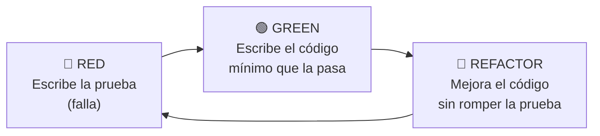

# Pruebas Unitarias: Concepto y Estructura

Una **prueba unitaria** es un fragmento de código que verifica el comportamiento de una unidad de producción — generalmente un método — de forma aislada y repetible. Es la prueba más pequeña y más rápida que existe, y la base de cualquier estrategia de calidad sólida.

```java
// La clase de producción
public class Calculator {
    public int add(int a, int b) {
        return a + b;
    }
}

// Su prueba unitaria
@Test
void add_twoIntegers_returnsTheirSum() {
    Calculator calc   = new Calculator();
    int        result = calc.add(3, 4);
    assertEquals(7, result);
}
```

---

## Características de una buena prueba unitaria

Una prueba unitaria de calidad cumple las propiedades **F.I.R.S.T.**:

| Propiedad | Significado | ¿Qué implica? |
|-----------|------------|---------------|
| **F**ast | Rápida | Se ejecuta en milisegundos; sin acceso a red o disco |
| **I**solated | Aislada | No depende de otras pruebas ni de estado compartido |
| **R**epeatable | Repetible | Produce el mismo resultado siempre, en cualquier entorno |
| **S**elf-validating | Autovalidable | Pasa o falla sin intervención humana |
| **T**imely | Oportuna | Escrita junto al código que prueba (o antes, en TDD) |

---

## El patrón AAA

Todas las pruebas bien estructuradas siguen el patrón **Arrange – Act – Assert**:

```java
@Test
void applyDiscount_tenPercent_reducesTotalByTen() {
    // Arrange: preparar el contexto
    ShoppingCart cart = new ShoppingCart();
    cart.addItem(100.0);

    // Act: ejecutar la acción bajo prueba
    cart.applyDiscount(10);

    // Assert: verificar el resultado
    assertEquals(90.0, cart.getTotal(), 0.001);
}
```

Mantener esta separación hace que la prueba sea fácil de leer y de depurar cuando falla.

---

## Nomenclatura de pruebas

Un buen nombre de prueba describe:
1. **Qué** se está probando (el método).
2. **Con qué condición** (el escenario de entrada).
3. **Qué resultado** se espera.

Patrón recomendado: `metodoProbado_condicion_resultadoEsperado`

```java
// Bien nombradas:
void add_negativeNumbers_returnsNegativeSum()
void withdraw_amountExceedsBalance_returnsFalse()
void getFullName_firstAndLastName_returnsCombined()

// Mal nombradas:
void test1()
void testAdd()
void addTest_works()
```

---

## Qué probar y qué no probar

### Sí probar:

- **Lógica de negocio**: cálculos, transformaciones, validaciones.
- **Casos límite**: valores en los extremos (`0`, `null`, lista vacía, número máximo).
- **Comportamiento ante errores**: ¿lanza la excepción correcta? ¿devuelve `false` en lugar de explotar?

```java
@Test
void divide_byZero_throwsArithmeticException() {
    Calculator calc = new Calculator();
    assertThrows(ArithmeticException.class, () -> calc.divide(10, 0));
}

@Test
void getFirstElement_emptyList_returnsEmptyOptional() {
    ListUtils utils  = new ListUtils();
    Optional  result = utils.getFirst(new ArrayList<>());
    assertTrue(result.isEmpty());
}
```

### No probar:

- **Getters y setters triviales** que no contienen lógica.
- **Constructores simples** que solo asignan parámetros.
- **Código de terceros** (frameworks, librerías): ya tienen sus propias pruebas.

---

## TDD: Test-Driven Development

El **Desarrollo Guiado por Pruebas** invierte el orden habitual: primero se escribe la prueba (que falla), luego el código mínimo para que pase, y finalmente se refactoriza.



Beneficios del TDD:
- Fuerza a diseñar la API de la clase antes de implementarla.
- Garantiza cobertura del 100 % de la lógica nueva.
- El diseño resultante tiende a ser más modular y testable.

---

## Ejemplo completo: clase BankAccount

### Clase de producción

```java
public class BankAccount {
    private double balance;

    public BankAccount(double initialBalance) {
        if (initialBalance < 0) {
            throw new IllegalArgumentException("El saldo inicial no puede ser negativo");
        }
        this.balance = initialBalance;
    }

    public double getBalance() {
        return balance;
    }

    public void deposit(double amount) {
        if (amount <= 0) throw new IllegalArgumentException("El importe debe ser positivo");
        balance += amount;
    }

    public boolean withdraw(double amount) {
        if (amount <= 0) throw new IllegalArgumentException("El importe debe ser positivo");
        if (amount > balance) return false;
        balance -= amount;
        return true;
    }
}
```

### Suite de pruebas

```java
class BankAccountTest {

    @Test
    void constructor_negativeBalance_throwsIllegalArgumentException() {
        assertThrows(IllegalArgumentException.class,
            () -> new BankAccount(-100));
    }

    @Test
    void deposit_positiveAmount_increasesBalance() {
        BankAccount account = new BankAccount(100.0);
        account.deposit(50.0);
        assertEquals(150.0, account.getBalance(), 0.001);
    }

    @Test
    void deposit_zeroAmount_throwsIllegalArgumentException() {
        BankAccount account = new BankAccount(100.0);
        assertThrows(IllegalArgumentException.class,
            () -> account.deposit(0));
    }

    @Test
    void withdraw_sufficientFunds_returnsTrueAndDeductsAmount() {
        BankAccount account = new BankAccount(200.0);
        boolean result = account.withdraw(80.0);
        assertTrue(result);
        assertEquals(120.0, account.getBalance(), 0.001);
    }

    @Test
    void withdraw_insufficientFunds_returnsFalseAndKeepsBalance() {
        BankAccount account = new BankAccount(50.0);
        boolean result = account.withdraw(100.0);
        assertFalse(result);
        assertEquals(50.0, account.getBalance(), 0.001);
    }
}
```

Cada prueba cubre un único escenario y tiene un nombre descriptivo. Si alguna falla, el nombre indica exactamente qué se rompió.

---

## Archivos relacionados

- [d-junit5.md](d-junit5.md) — JUnit 5: anotaciones y aserciones
- [e-mocks-y-stubs.md](e-mocks-y-stubs.md) — Mocks y stubs para aislar dependencias
