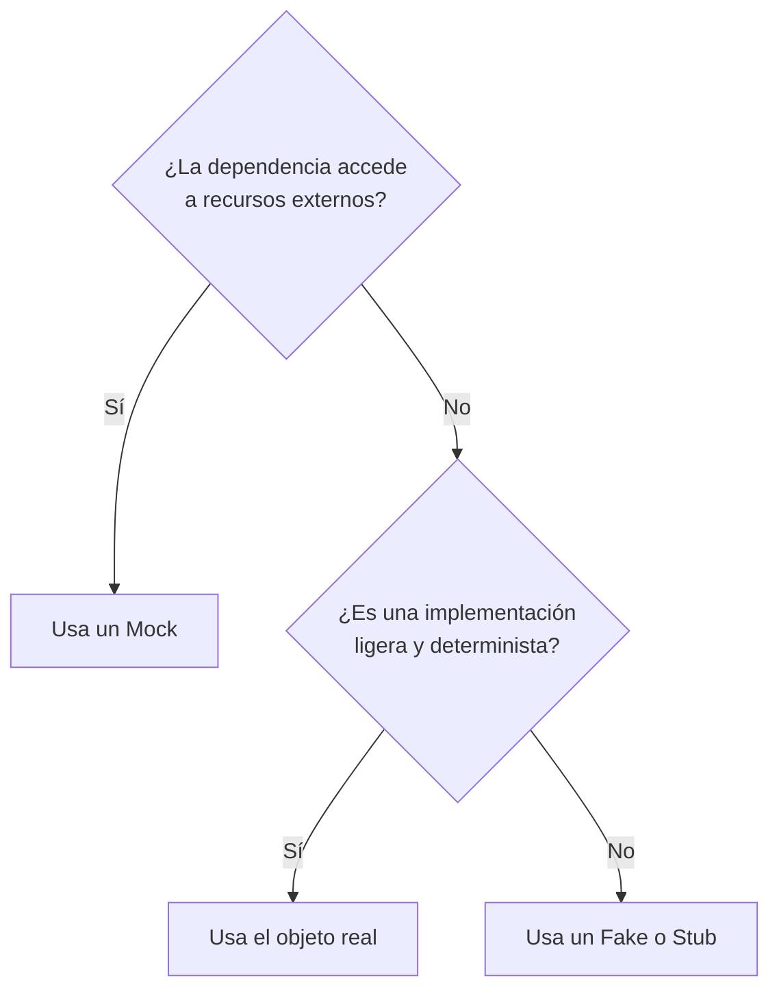

# Mocks y Stubs: Aislar Dependencias

Cuando una clase bajo prueba depende de otras clases (base de datos, API externa, servicio de email…), no podemos probarla de forma aislada sin controlar esas dependencias. Los **dobles de prueba** resuelven este problema.

```java
// OrderService depende de un PaymentGateway real.
// En la prueba, lo sustituimos por uno simulado.
PaymentGateway mockGateway = mock(PaymentGateway.class);
when(mockGateway.charge(anyDouble())).thenReturn(true);

OrderService service = new OrderService(mockGateway);
```

---

## Tipos de dobles de prueba

| Tipo | ¿Qué hace? | Uso típico |
|------|-----------|-----------|
| **Dummy** | Objeto pasado pero nunca usado | Rellenar parámetros obligatorios |
| **Stub** | Devuelve respuestas predefinidas | Simular consultas a base de datos |
| **Mock** | Verifica que se llamó correctamente | Comprobar interacciones entre objetos |
| **Spy** | Envuelve un objeto real y espía llamadas | Verificar llamadas sobre implementación real |
| **Fake** | Implementación alternativa simplificada | Base de datos en memoria |

En la práctica, los términos **mock** y **stub** se usan de forma intercambiable en el día a día.

---

## Mockito: el framework estándar

**Mockito** es la librería más usada para crear dobles de prueba en Java. Se integra perfectamente con JUnit 5.

### Dependencia Maven

```xml
<dependency>
    <groupId>org.mockito</groupId>
    <artifactId>mockito-junit-jupiter</artifactId>
    <version>5.12.0</version>
    <scope>test</scope>
</dependency>
```

---

## Crear y configurar mocks

```java
import org.mockito.Mockito;
import static org.mockito.Mockito.*;

// Crear un mock de la interfaz
UserRepository mockRepo = mock(UserRepository.class);

// Configurar su comportamiento (stub)
when(mockRepo.findById(1)).thenReturn(new User(1, "Ana García"));
when(mockRepo.findById(99)).thenReturn(null);
```

---

## Ejemplo completo

### Clases de producción

```java
public interface UserRepository {
    User findById(int id);
    void save(User user);
}

public class UserService {
    private UserRepository repository;

    public UserService(UserRepository repository) {
        this.repository = repository;
    }

    public String getDisplayName(int userId) {
        User user = repository.findById(userId);
        if (user == null) return "Usuario desconocido";
        return user.getName().toUpperCase();
    }

    public void registerUser(String name, String email) {
        User user = new User(0, name);
        repository.save(user);
    }
}
```

### Suite de pruebas con Mockito

```java
import org.junit.jupiter.api.Test;
import org.junit.jupiter.api.extension.ExtendWith;
import org.mockito.InjectMocks;
import org.mockito.Mock;
import org.mockito.junit.jupiter.MockitoExtension;
import static org.mockito.Mockito.*;
import static org.junit.jupiter.api.Assertions.*;

@ExtendWith(MockitoExtension.class)
class UserServiceTest {

    @Mock
    private UserRepository mockRepository; // Mockito crea el mock automáticamente

    @InjectMocks
    private UserService service; // Mockito inyecta el mock en el servicio

    @Test
    void getDisplayName_existingUser_returnsUpperCaseName() {
        // Arrange: configurar el stub
        when(mockRepository.findById(1))
            .thenReturn(new User(1, "Ana García"));

        // Act
        String result = service.getDisplayName(1);

        // Assert
        assertEquals("ANA GARCÍA", result);
    }

    @Test
    void getDisplayName_unknownUser_returnsDefaultMessage() {
        // Arrange: el repositorio devuelve null para id desconocido
        when(mockRepository.findById(99)).thenReturn(null);

        // Act
        String result = service.getDisplayName(99);

        // Assert
        assertEquals("Usuario desconocido", result);
    }

    @Test
    void registerUser_validData_callsSaveOnRepository() {
        // Act
        service.registerUser("Carlos López", "carlos@email.com");

        // Assert: verificar que save fue llamado exactamente una vez
        verify(mockRepository, times(1)).save(any(User.class));
    }
}
```

---

## Verificación de interacciones

Mockito permite verificar **cómo** se usó el mock, no solo el resultado.

```java
// Verificar que se llamó exactamente una vez
verify(mockRepository, times(1)).save(any(User.class));

// Verificar que nunca se llamó
verify(mockRepository, never()).delete(any());

// Verificar que se llamó con un argumento específico
verify(mockRepository).findById(42);

// Verificar que no quedan interacciones sin verificar
verifyNoMoreInteractions(mockRepository);
```

---

## Cuándo usar mock vs. objeto real



**Usa mock** cuando la dependencia:
- Accede a base de datos, red o sistema de ficheros.
- Es lenta o tiene efectos secundarios (envío de emails, pagos).
- Aún no está implementada.

**Usa el objeto real** cuando:
- Es una clase de valor simple (ej: `Money`, `Address`).
- Su lógica es parte integral de lo que estás probando.

---

## Archivos relacionados

- [d-junit5.md](d-junit5.md) — JUnit 5: anotaciones y aserciones
- [f-cobertura-de-codigo.md](f-cobertura-de-codigo.md) — Cobertura de código
