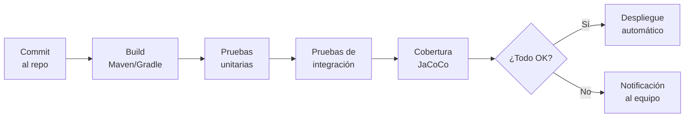
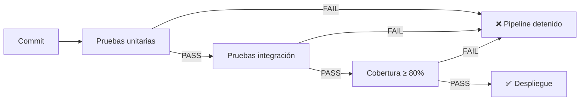
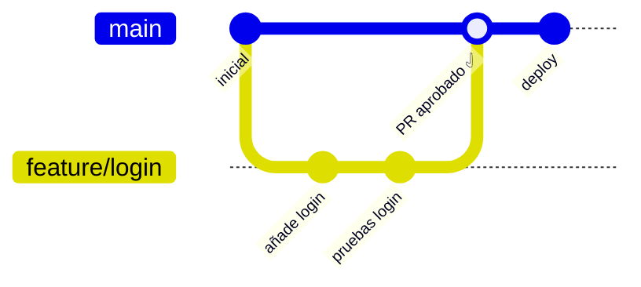

# CI/CD y su Relación con las Pruebas de Software

**CI/CD** (*Integración Continua / Entrega Continua*) es el conjunto de prácticas que automatizan la compilación, las pruebas y el despliegue del software cada vez que un desarrollador introduce un cambio en el repositorio. Las pruebas son el corazón del pipeline: sin ellas, CI/CD no tiene valor.



---

## Integración Continua (CI)

La **Integración Continua** establece que cada desarrollador integra su trabajo en la rama principal al menos una vez al día. Un servidor de CI detecta el cambio, construye el proyecto y ejecuta todas las pruebas automáticamente.

### ¿Qué resuelve?

Sin CI, los equipos suelen acumular cambios durante días o semanas y luego fusionarlos todos a la vez, generando conflictos masivos y errores difíciles de rastrear. Esto se conoce como **integration hell**.

Con CI:
- Los conflictos se detectan pronto, cuando son pequeños.
- Cada commit tiene su resultado de pruebas asociado.
- El código en la rama principal siempre está en un estado funcional.

---

## Entrega Continua (CD)

La **Entrega Continua** extiende la CI para que, si todas las pruebas pasan, el artefacto generado esté listo para desplegarse en producción con un solo clic (o automáticamente, en el caso del **Despliegue Continuo**).

| Concepto | Automatización | Intervención humana |
|---------|---------------|---------------------|
| **CI** | Build + pruebas | No necesaria |
| **Entrega Continua** | CI + empaquetado + staging | Aprobación manual para producción |
| **Despliegue Continuo** | Todo automatizado | Ninguna |

---

## Las pruebas como puerta de calidad (*Quality Gate*)

En un pipeline de CI/CD, las pruebas actúan como **puertas de calidad**: si una prueba falla, el pipeline se detiene y no se permite el despliegue.



Esto garantiza que **nunca llega código roto a producción** siempre que las pruebas estén bien escritas.

---

## GitHub Actions: pipeline de CI en la práctica

**GitHub Actions** es la plataforma de CI/CD integrada en GitHub. Un pipeline se define en un fichero YAML dentro del repositorio.

### Estructura de un workflow

```
.github/
└── workflows/
    └── ci.yml
```

### Ejemplo: pipeline CI para un proyecto Java con Maven

```yaml
name: CI — Build y Pruebas

on:
  push:
    branches: [ main, develop ]
  pull_request:
    branches: [ main ]

jobs:
  build-and-test:
    runs-on: ubuntu-latest

    steps:
      - name: Checkout del código
        uses: actions/checkout@v4

      - name: Configurar JDK 21
        uses: actions/setup-java@v4
        with:
          java-version: '21'
          distribution: 'temurin'

      - name: Compilar y ejecutar pruebas
        run: mvn verify

      - name: Publicar informe de cobertura (JaCoCo)
        uses: actions/upload-artifact@v4
        with:
          name: jacoco-report
          path: target/site/jacoco/
```

Con este fichero, GitHub ejecuta automáticamente las pruebas en cada push y en cada pull request. Si alguna prueba falla, el pull request queda bloqueado.

---

## Otras plataformas de CI/CD

| Plataforma | Integración | Uso típico |
|------------|------------|-----------|
| **GitHub Actions** | GitHub | Proyectos open source y empresariales |
| **GitLab CI** | GitLab | Entornos corporativos con GitLab self-hosted |
| **Jenkins** | Cualquier repo | Instalación on-premise tradicional |
| **CircleCI** | GitHub/Bitbucket | Proyectos con builds complejos |
| **Bitbucket Pipelines** | Bitbucket | Integrado con Jira y Confluence |

---

## Estrategia de ramas y CI

El pipeline de CI/CD encaja directamente con las estrategias de ramas vistas en el Tema 1:



- Cada **rama de feature** tiene su propio pipeline.
- La fusión a `main` solo está permitida si el pipeline pasa.
- El merge a `main` puede disparar un despliegue automático a producción.

---

## Buenas prácticas de CI/CD

1. **Las pruebas deben ser rápidas**: un pipeline que tarda 30 minutos se ignora. Las pruebas unitarias deben completarse en menos de 2 minutos.
2. **Falla rápido**: ejecuta primero las pruebas más rápidas (unitarias), luego las lentas (integración, E2E).
3. **El pipeline es sagrado**: nunca ignores una prueba que falla; arréglala o elimínala, pero no la deshabilites indefinidamente.
4. **Un solo repositorio de verdad**: el pipeline siempre construye desde el repositorio, nunca desde la máquina local de un desarrollador.
5. **Pruebas en entorno limpio**: cada ejecución del pipeline parte de un entorno reproducible (contenedor Docker, máquina virtual efímera).

---

## Archivos relacionados

- [a-introduccion.md](a-introduccion.md) — Introducción a las pruebas de software
- [f-cobertura-de-codigo.md](f-cobertura-de-codigo.md) — Cobertura de código y umbrales en CI
- [h-errores-comunes.md](h-errores-comunes.md) — Errores comunes
