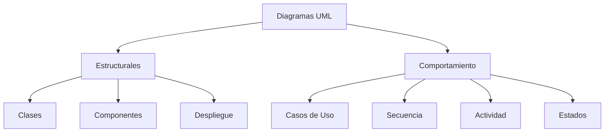

# Introducción a los Diagramas de Comportamiento UML

Los **diagramas de comportamiento** UML modelan cómo se comporta un sistema a lo largo del tiempo: qué hace, cómo responde a eventos y cómo interactúan sus partes. A diferencia de los diagramas estructurales (como el diagrama de clases), los de comportamiento capturan el **aspecto dinámico** del software.

---

## ¿Para qué se usan los diagramas de comportamiento?

- Comunicar **requisitos funcionales** entre el equipo técnico y el cliente.
- Documentar **flujos de interacción** entre usuarios y sistema.
- Describir el **orden exacto de mensajes** que se intercambian durante una operación.
- Detectar **casos límite y flujos alternativos** antes de escribir código.

---

## Tipos de diagramas de comportamiento en este tema

| Diagrama | Pregunta que responde | Cuándo usarlo |
|---|---|---|
| **Casos de Uso** | ¿Qué puede hacer cada actor con el sistema? | Fase de análisis de requisitos |
| **Secuencia** | ¿En qué orden se envían los mensajes? | Diseño detallado de una operación |

En este tema profundizaremos en estos dos tipos, que son los más utilizados en proyectos reales de desarrollo.

---

## Relación entre ambos diagramas

Los diagramas de **casos de uso** y de **secuencia** son complementarios:

1. El **diagrama de casos de uso** define *qué* puede hacer el sistema visto desde fuera.
2. El **diagrama de secuencia** explica *cómo* se realiza internamente cada caso de uso.

> Ejemplo: el caso de uso "Realizar pedido" se descompone en un diagrama de secuencia que muestra los mensajes entre el cliente, la aplicación, el servicio de stock y la pasarela de pago.

---

## Herramientas de modelado

Los diagramas UML de comportamiento pueden dibujarse con herramientas como PlantUML, Draw.io, Lucidchart o, como en estos apuntes, con **Mermaid** integrado directamente en Markdown. Mermaid permite generar diagramas a partir de texto, lo que facilita mantenerlos junto al código en el repositorio.

---

## Archivos relacionados

- [b-diagramas-de-casos-de-uso.md](b-diagramas-de-casos-de-uso.md)
- [c-relaciones-casos-de-uso.md](c-relaciones-casos-de-uso.md)
- [d-diagramas-de-secuencia.md](d-diagramas-de-secuencia.md)
- [e-mensajes-y-fragmentos.md](e-mensajes-y-fragmentos.md)
