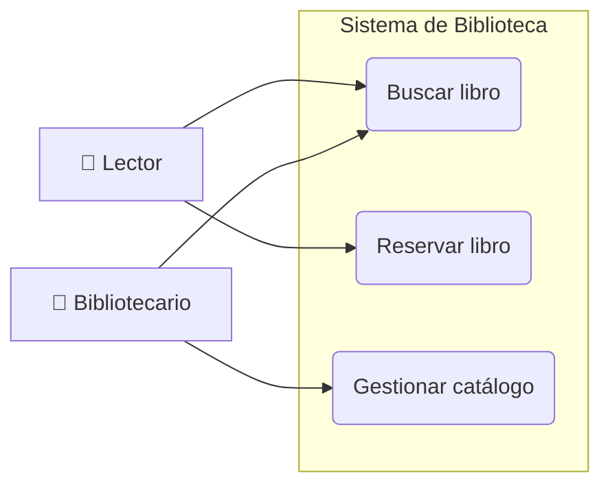
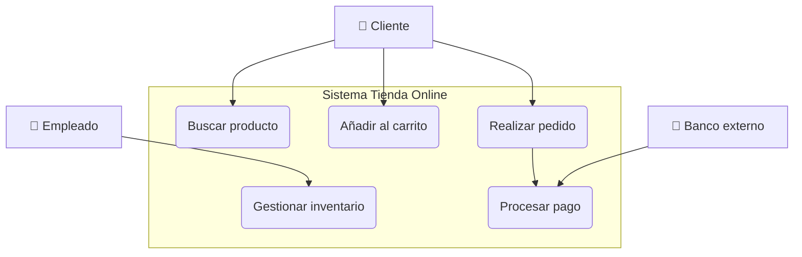

# Diagramas de Casos de Uso

Un **diagrama de casos de uso** representa las funcionalidades que ofrece un sistema vistas desde la perspectiva de los usuarios externos. Responde a la pregunta: *¿qué puede hacer cada tipo de usuario con el sistema?*

---

## Elementos del diagrama

### Actor

Un **actor** representa cualquier entidad externa al sistema que interactúa con él. Puede ser una persona, otro sistema software o un dispositivo hardware.

| Tipo de actor | Descripción | Ejemplo |
|---|---|---|
| **Actor principal** | Inicia la interacción; obtiene valor del sistema | Cliente que realiza un pedido |
| **Actor secundario** | Participa para que el sistema pueda completar el caso de uso | Pasarela de pago externa |

En Mermaid se representa usando la notación `actor` en diagramas de secuencia, o como nodo externo al rectángulo del sistema en diagramas de flujo.

---

### Caso de uso

Un **caso de uso** describe una funcionalidad completa que el sistema ofrece a un actor. Se nombra siempre con un **verbo en infinitivo** seguido de un complemento.

| Correcto | Incorrecto |
|---|---|
| Registrar usuario | Registro |
| Realizar pedido | Pedidos |
| Cancelar reserva | Cancelación de reservas del sistema |

---

### Frontera del sistema (*System Boundary*)

Un rectángulo que delimita el sistema. Todo lo que está **dentro** son casos de uso; todo lo que está **fuera** son actores. Deja claro qué es responsabilidad del sistema y qué no.

---

## Ejemplo completo — Tienda online

---

## Relación actor — caso de uso

La **asociación** entre un actor y un caso de uso indica que ese actor puede iniciar o participar en esa funcionalidad. Es la relación más básica del diagrama y se dibuja como una línea sólida sin dirección.

---

## Nivel de detalle adecuado

Un error frecuente es hacer los casos de uso demasiado pequeños (casi a nivel de clic de ratón) o demasiado grandes (un único caso de uso que engloba todo el sistema).

| Demasiado fino | Adecuado | Demasiado grueso |
|---|---|---|
| Hacer clic en "Enviar" | Registrar usuario | Gestionar usuarios |
| Introducir contraseña | Iniciar sesión | Operar con el sistema |
| Ver mensaje de error | Recuperar contraseña | Administrar todo |

La regla práctica: un caso de uso debe representar una **transacción completa de valor** para el actor.

---

## Archivos relacionados

- [c-relaciones-casos-de-uso.md](c-relaciones-casos-de-uso.md)
