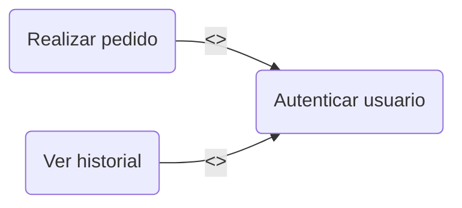
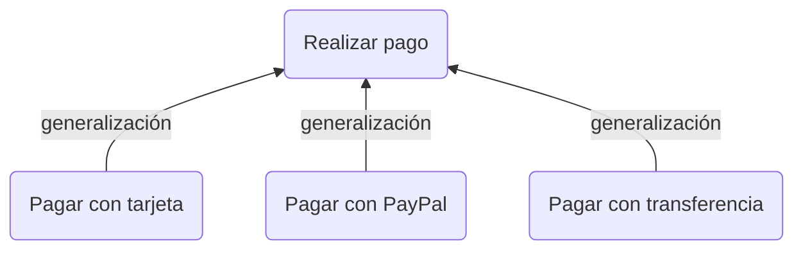
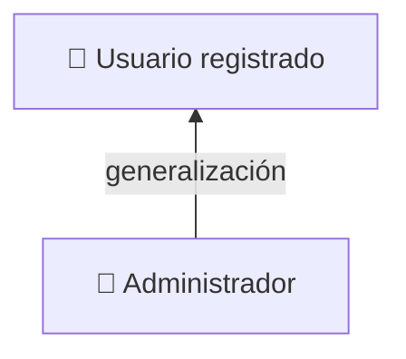

# Relaciones en los Diagramas de Casos de Uso

Además de la asociación básica entre actor y caso de uso, UML define tres relaciones entre **casos de uso**: `<<include>>`, `<<extend>>` y la **generalización**. Cada una expresa un tipo diferente de dependencia funcional.

---

## `<<include>>` — Incluir

La relación **`<<include>>`** indica que un caso de uso **siempre** invoca a otro como parte de su flujo. El caso de uso incluido extrae comportamiento común que se reutiliza en varios lugares.

> Analogía: igual que un método privado que siempre se llama desde varios métodos públicos.

- La dirección de la flecha va del caso de uso **base** al caso de uso **incluido**.
- El caso incluido **no tiene sentido por sí solo** sin el caso que lo incluye.



En este ejemplo, tanto "Realizar pedido" como "Ver historial" siempre requieren autenticar al usuario antes. El comportamiento de autenticación se extrae a su propio caso de uso para evitar repetirlo.

---

## `<<extend>>` — Extender

La relación **`<<extend>>`** indica que un caso de uso **puede** añadir comportamiento opcional a otro bajo cierta condición. El caso de uso extensor solo entra en juego si se cumple la condición.

> Analogía: como un plugin o un módulo opcional que enriquece el funcionamiento base solo cuando se activa.

- La dirección de la flecha va del caso de uso **extensor** al caso de uso **base**.
- El caso base funciona correctamente **sin** el extensor.
- La condición se indica entre corchetes sobre la flecha.

```mermaid
graph LR
    UC2(Aplicar descuento) -->|<<extend>>\n[tiene cupón]| UC1(Realizar pedido)
    UC3(Enviar notificación SMS) -->|<<extend>>\n[alertas activadas]| UC1
```

Aquí "Realizar pedido" funciona sin descuentos ni notificaciones. Pero si el cliente tiene un cupón, se activa "Aplicar descuento". Si tiene alertas activadas, se activa "Enviar notificación SMS".

---

## Comparativa include vs extend

| | `<<include>>` | `<<extend>>` |
|---|---|---|
| ¿Se ejecuta siempre? | Sí, siempre | Solo si se cumple la condición |
| ¿Quién depende de quién? | El base depende del incluido | El extensor depende del base |
| Dirección de flecha | Base → Incluido | Extensor → Base |
| Propósito principal | Reutilizar comportamiento común | Añadir comportamiento opcional |
| ¿El caso secundario existe solo? | Puede hacerlo o no | No tiene sentido sin el base |

---

## Generalización entre casos de uso

La **generalización** entre casos de uso indica que un caso de uso hijo hereda el comportamiento del padre y puede especializarlo o añadir pasos adicionales.



El caso de uso padre define el flujo general; los hijos concretan cómo se realiza en cada variante.

---

## Generalización entre actores

Los **actores también pueden tener jerarquía**. Un actor hijo hereda todas las asociaciones del actor padre y puede participar en casos de uso adicionales.



El Administrador puede hacer todo lo que hace un Usuario registrado, más las operaciones de administración exclusivas de su rol.

---

## Ejemplo integrado — Sistema bancario

```mermaid
graph TB
    subgraph Sistema Bancario
        UC1(Consultar saldo)
        UC2(Realizar transferencia)
        UC3(Autenticar usuario)
        UC4(Registrar operación)
        UC5(Aplicar límite diario)
        UC6(Bloquear cuenta)
    end

    Cliente[👤 Cliente] --> UC1
    Cliente --> UC2
    UC1 -->|<<include>>| UC3
    UC2 -->|<<include>>| UC3
    UC2 -->|<<include>>| UC4
    UC5 -->|<<extend>>\n[supera límite]| UC2
    Admin[👤 Administrador] --> UC6
    Admin[👤 Administrador] --> UC1
```

---

## Buenas prácticas

- Usa `<<include>>` cuando el comportamiento extraído **siempre** es necesario y aparece en al menos dos casos de uso.
- Usa `<<extend>>` para modelar **variantes opcionales** o **flujos de excepción**, no para toda la lógica condicional.
- No abuses de `<<extend>>`: si una condición es parte natural del flujo principal, modélala dentro del propio caso de uso.
- La generalización de actores es útil para modelar **roles con privilegios acumulativos** (usuario < moderador < administrador).
