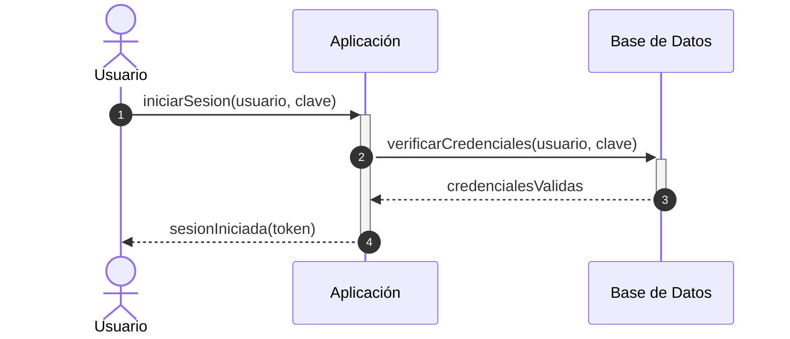
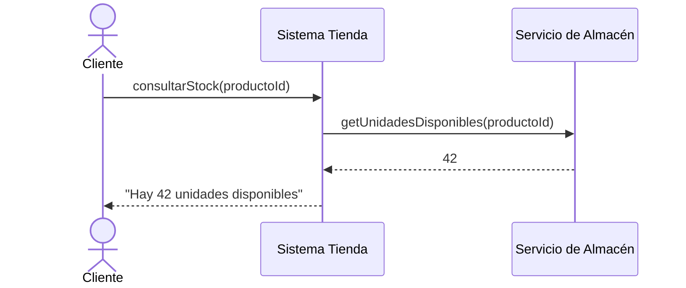
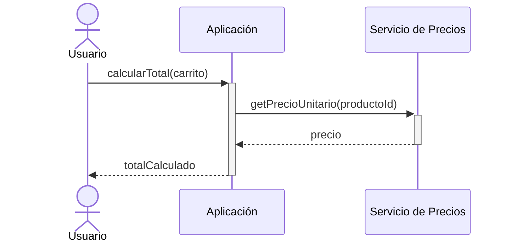
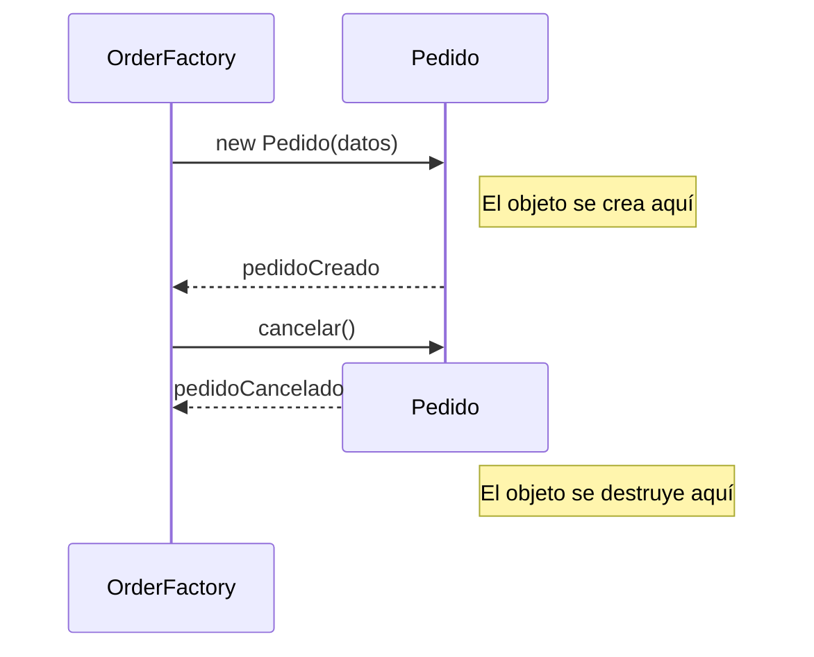
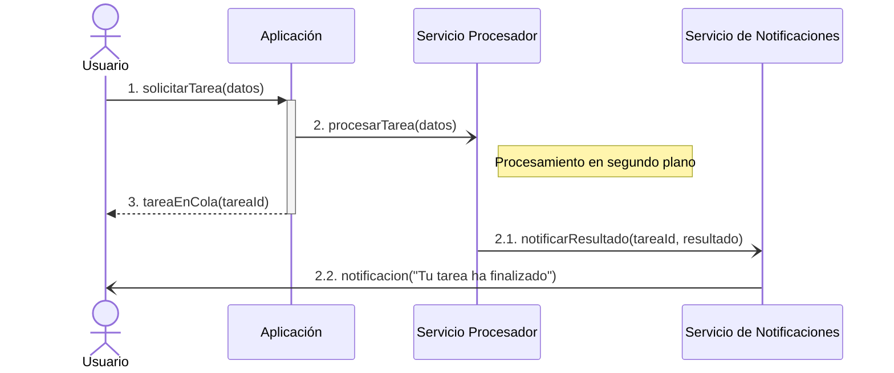

# Diagramas de Secuencia

Un **diagrama de secuencia** muestra cómo interactúan un conjunto de participantes mediante mensajes ordenados en el tiempo. Mientras el diagrama de casos de uso responde a *qué* hace el sistema, el diagrama de secuencia responde a *cómo* lo hace internamente, mensaje a mensaje.

---

## Participantes

Los **participantes** son los elementos que intervienen en el diagrama. Se representan como columnas verticales ordenadas de izquierda a derecha siguiendo el flujo principal de comunicación.

| Tipo | Representación | Cuándo usarlo |
|---|---|---|
| **Sistema / Componente / Clase** | Rectángulo con el nombre | Cualquier sistema software, servicio o clase |
| **Actor** | Figura humana con el nombre | Persona u entidad externa al sistema |

En Mermaid se declaran con las palabras clave `participant` y `actor`:

---

## Línea de vida (*Lifeline*)

Cada participante tiene una **línea de vida**: una línea vertical discontinua que representa su existencia a lo largo del tiempo. El tiempo avanza **hacia abajo**. Los mensajes se dibujan como flechas horizontales entre líneas de vida.

---

## Barra de activación (*Activation box*)

Un rectángulo estrecho superpuesto sobre la línea de vida que indica que el participante está **procesando activamente** una operación. En Mermaid se activa con `+` al recibir el mensaje y se desactiva con `-` al devolver la respuesta.

- La barra se abre cuando el participante recibe una llamada.
- La barra se cierra cuando emite el retorno.
- Las barras pueden **anidarse** cuando hay llamadas encadenadas antes de responder.

En este ejemplo la barra de activación de `App` permanece abierta durante toda la operación porque está esperando la respuesta del `Servicio` antes de responder al `Usuario`.

---

## Creación y destrucción de objetos

Un participante puede **crearse** o **destruirse** durante el flujo del diagrama. En Mermaid, `create` instancia un nuevo participante y `destroy` lo elimina.

---

## Numeración de mensajes

Los mensajes pueden numerarse para facilitar su referencia en documentación. En Mermaid se activa con `autonumber`. Para operaciones **asíncronas**, donde los mensajes no siguen un orden temporal estricto, se usa **numeración anidada** manual (`2.1`, `2.2`...) para indicar que esos mensajes son consecuencia del mensaje `2`.

---

## Operación síncrona vs. asíncrona

| | Síncrona | Asíncrona |
|---|---|---|
| El emisor espera respuesta | Sí | No |
| Flecha de solicitud | Línea sólida, punta rellena `->>`  | Línea sólida, punta abierta `-)`  |
| Flecha de retorno | Línea discontinua `-->>`  | Línea discontinua `--)`  |
| Numeración | `autonumber` secuencial | Numeración anidada manual |

### Ejemplo — operación asíncrona

El emisor continúa su flujo sin esperar. La respuesta llega más tarde, normalmente a través de un evento o notificación.

---

## Archivos relacionados

- [e-mensajes-y-fragmentos.md](e-mensajes-y-fragmentos.md)
