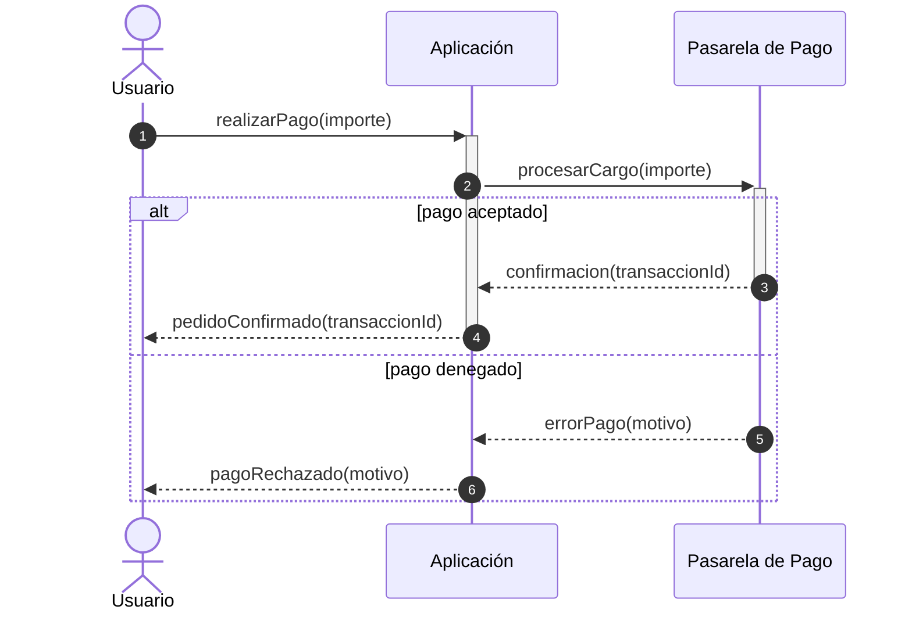
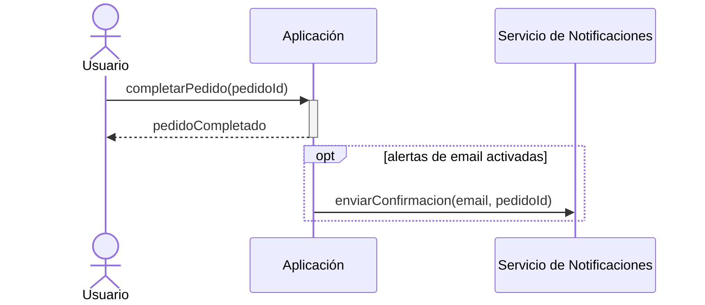
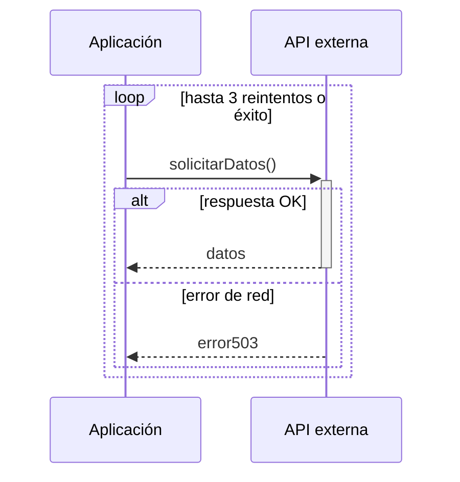
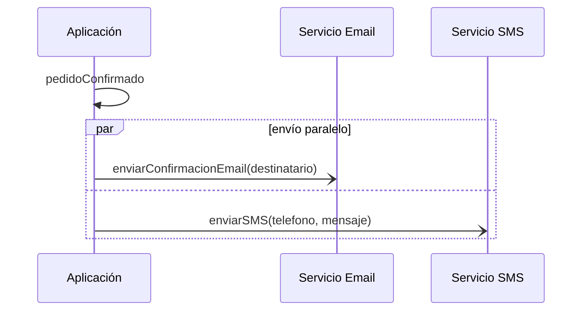
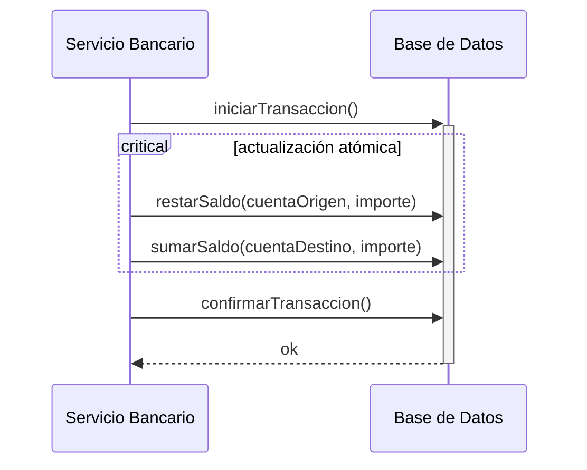
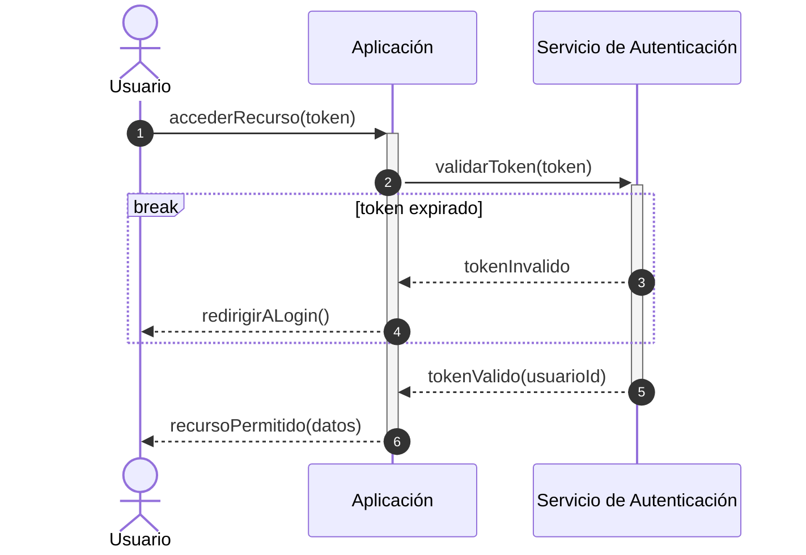
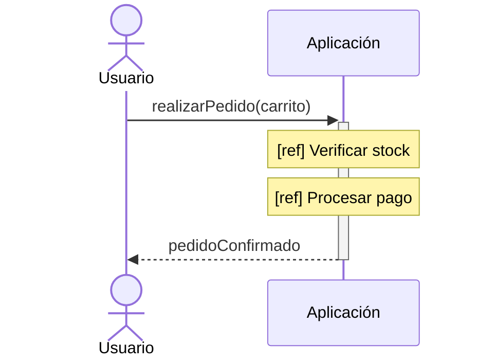
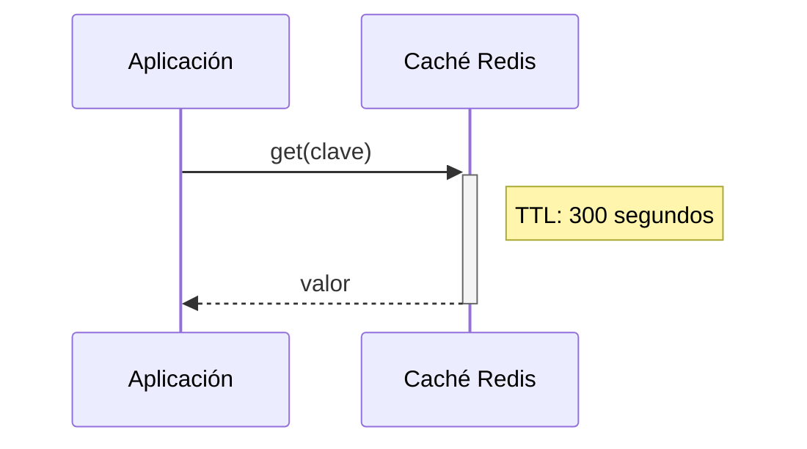

# Tipos de Mensaje y Fragmentos Combinados

Los **mensajes** son el corazón del diagrama de secuencia. Los **fragmentos combinados** permiten expresar lógica de control (condiciones, bucles, paralelismo) dentro del propio diagrama sin necesidad de texto adicional.

---

## Tipos de mensaje

| Tipo | Notación Mermaid | Cuándo usarlo |
|---|---|---|
| **Síncrono — solicitud** | `->>` | El emisor se bloquea y espera respuesta |
| **Síncrono — retorno** | `-->>` | Devuelve el resultado al emisor original |
| **Asíncrono — solicitud** | `-)` | El emisor no se bloquea y continúa su ejecución |
| **Asíncrono — retorno** | `--)` | Respuesta diferida de un mensaje asíncrono |
| **Crear participante** | `create` + `->>` | Instancia un nuevo participante en mitad del diagrama |
| **Destruir participante** | `destroy` + `->>` | El participante deja de existir |

### Resumen visual

```
Emisor  ->>  Receptor    Síncrono — solicitud (el emisor espera)
Emisor -->>  Receptor    Síncrono — retorno
Emisor  -)   Receptor    Asíncrono — solicitud (el emisor no espera)
Emisor --)   Receptor    Asíncrono — retorno diferido
```

---

## Fragmentos combinados (*Combined Fragments*)

Los **fragmentos combinados** son rectángulos que engloban un grupo de mensajes y llevan una **etiqueta de operador** en la esquina superior izquierda. Expresan lógica de control sin salir del diagrama.

---

### `alt` — Alternativa (if / else)

Para flujos **mutuamente excluyentes**. Cada alternativa se separa con `else` y su condición va entre corchetes.



---

### `opt` — Opcional (if sin else)

Para un flujo que **puede ocurrir o no** según una condición. Si la condición no se cumple, el fragmento se omite.



---

### `loop` — Bucle

Para **repetir** un conjunto de mensajes mientras se cumpla una condición. La condición se indica entre corchetes en la etiqueta.



---

### `par` — Paralelo

Para mensajes que ocurren de forma **simultánea o concurrente**. Cada rama paralela se separa con `and`.



---

### `critical` — Sección crítica

Para operaciones que deben ejecutarse de forma **atómica**, sin posibilidad de interrupción concurrente. Garantiza que ningún otro proceso interfiere mientras se ejecuta el bloque.



---

### `break` — Interrupción

Para modelar una **salida anticipada o excepcional** del flujo principal. Si la condición se cumple, se abandona el flujo y se ejecuta el bloque `break`.



---

### `ref` — Referencia

Para **referenciar otro diagrama de secuencia** sin repetir su contenido. Es útil cuando un diagrama se vuelve demasiado largo o cuando una interacción se reutiliza en varios diagramas.

:::info
Mermaid no soporta el fragmento `ref` de forma nativa. En la documentación se indica el nombre del diagrama referenciado como texto dentro de una nota.
:::



---

## Notas en el diagrama

Las **notas** son comentarios que clarifican algo que los mensajes solos no expresan suficientemente. En Mermaid se añaden con `Note right of`, `Note left of` o `Note over`.



---

## Buenas prácticas

- Ordenar los participantes de **izquierda a derecha** siguiendo el flujo principal para reducir el cruce de flechas.
- Usar **barras de activación** (`+` / `-`) cuando la duración del procesamiento es relevante.
- Limitar la profundidad de **fragmentos anidados** a 2 niveles para mantener la legibilidad.
- Añadir **notas** solo cuando el mensaje por sí solo no es suficientemente descriptivo.
- Separar diagramas muy largos usando el fragmento de **referencia** (`ref`) para dividirlos en partes manejables.
- Usar **mensajes asíncronos** (`-)`) cuando el emisor no depende de la respuesta para continuar su lógica.
