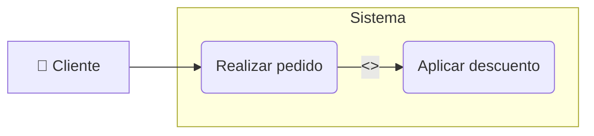
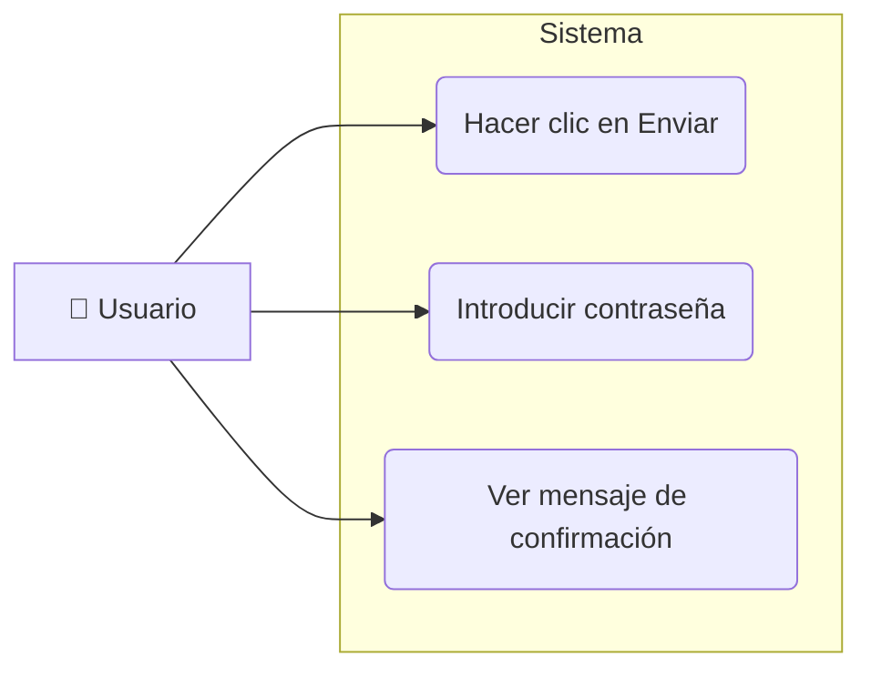
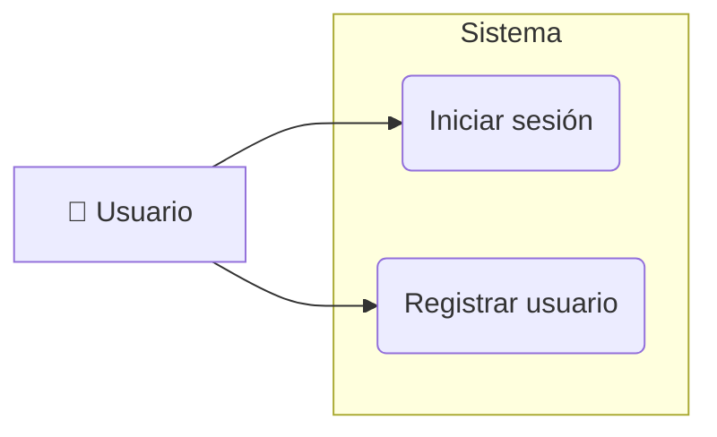
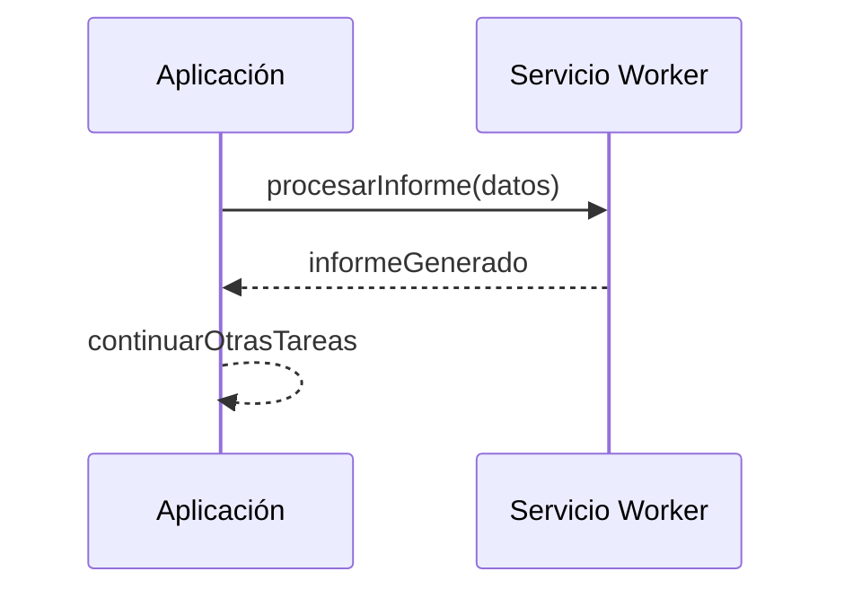
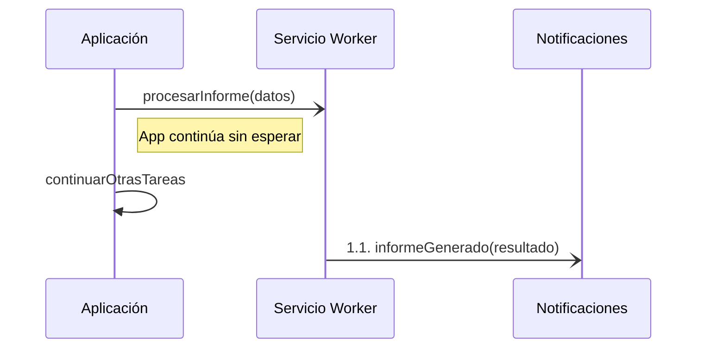
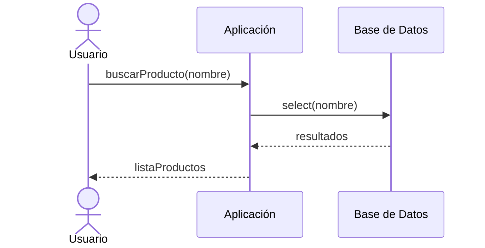
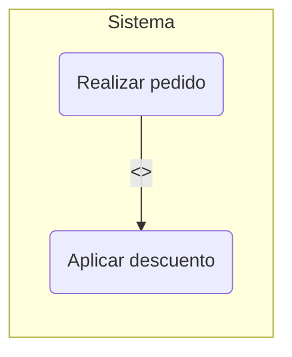
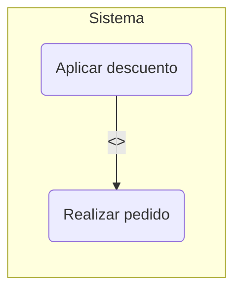
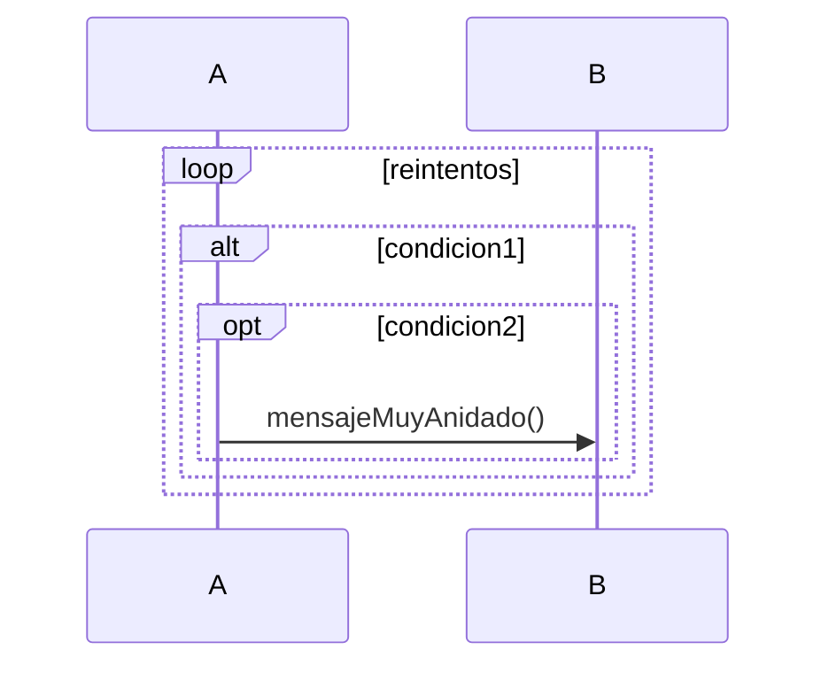
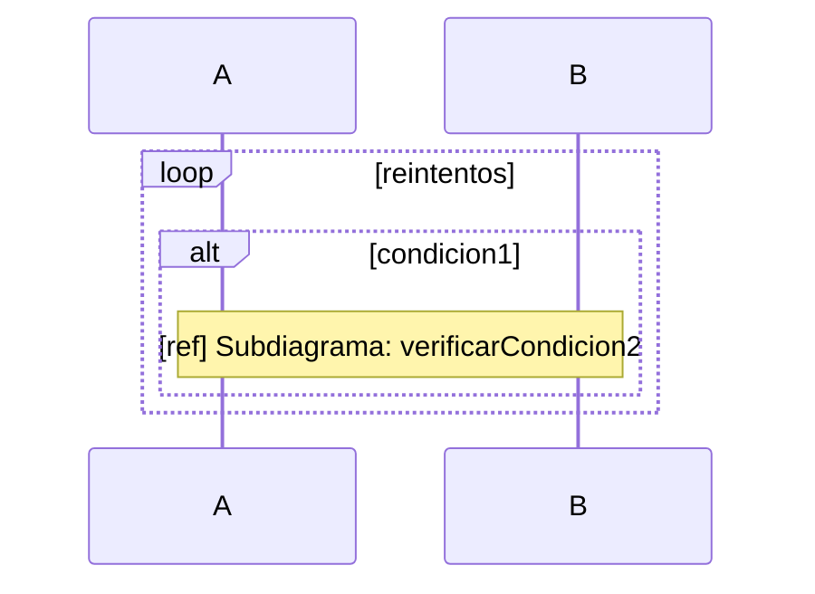

# Errores Comunes en Diagramas de Comportamiento

---

## Error 1: Confundir `<<include>>` con `<<extend>>`

El error más frecuente es usar `<<include>>` cuando la relación es opcional, o `<<extend>>` cuando el comportamiento siempre se ejecuta.

**Incorrecto** — usar `<<include>>` para algo que solo ocurre a veces:



*El descuento no siempre se aplica; solo cuando el cliente tiene un cupón.*

**Correcto** — usar `<<extend>>` con condición:

```mermaid
graph LR
    subgraph Sistema
        UC2(Aplicar descuento) -->|<<extend>>\n[tiene cupón]| UC1(Realizar pedido)
    end
    Cliente[👤 Cliente] --> UC1
```

---

## Error 2: Incluir pasos de interfaz gráfica como casos de uso

Los casos de uso deben representar **objetivos del actor**, no acciones de interfaz.

**Incorrecto:**



**Correcto:**



---

## Error 3: Usar mensajes síncronos cuando la operación es asíncrona

Si el emisor no espera la respuesta, la flecha debe ser asíncrona (`-)` en Mermaid), no síncrona (`->>`).

**Incorrecto** — una tarea de procesamiento en segundo plano representada como síncrona:



*Aquí `App` no puede continuar otras tareas si está bloqueada esperando la respuesta.*

**Correcto** — mensaje asíncrono que no bloquea al emisor:



---

## Error 4: Olvidar la barra de activación en llamadas que esperan respuesta

Sin barra de activación (`+` / `-`), el diagrama no refleja que el participante está ocupado procesando.

**Incorrecto** — sin barras de activación:



**Correcto** — con barras de activación:


---

## Error 5: Poner la flecha de `<<extend>>` en dirección incorrecta

La flecha de `<<extend>>` apunta del caso de uso **extensor** al **base**, no al revés. Un error habitual es dibujarla igual que `<<include>>`.

**Incorrecto** — flecha en dirección errónea:



**Correcto** — el extensor apunta al base:



---

## Error 6: Anidar demasiados fragmentos combinados

Más de 2 niveles de fragmentos anidados hacen el diagrama ilegible.

**Incorrecto** — tres niveles de anidamiento:



**Correcto** — extraer el fragmento interior a un diagrama separado y referenciar con una nota:



---

## Error 7: Nombrar los casos de uso como sustantivos en lugar de verbos

Los casos de uso deben expresar una **acción con valor** para el actor.

| Incorrecto | Correcto |
|---|---|
| Registro | Registrar usuario |
| Pedidos | Realizar pedido |
| Historial de compras | Consultar historial de compras |
| Pago | Procesar pago |
